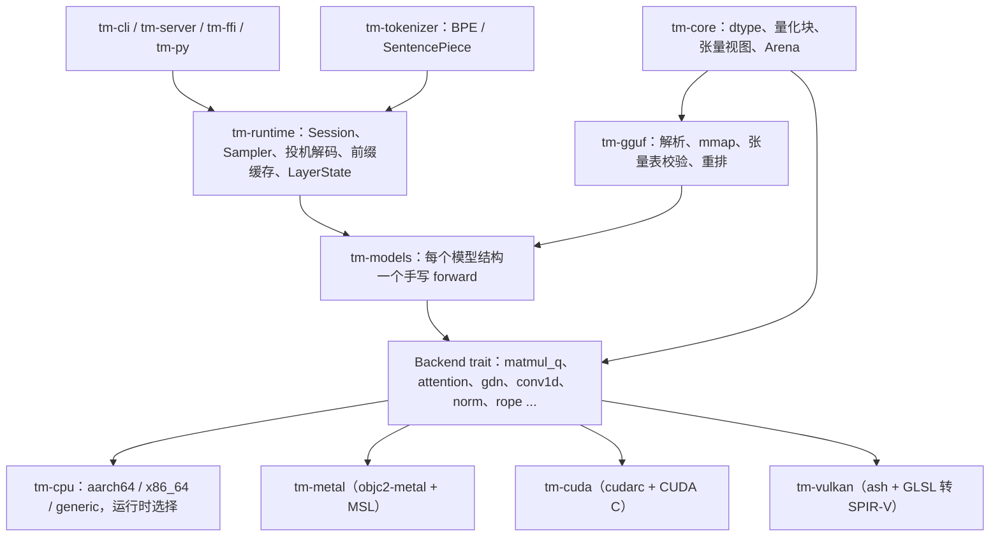

# 架构设计（Architecture）

> 状态：v0.1 草案。需求见 `REQUIREMENTS.md`，决策记录见 `DECISIONS.md`。

## 1. 核心原理

- **decode 受内存带宽限制**：每个 token 的耗时 ≈ 要读取的字节数 ÷ 有效带宽。提速手段只有两类：**少读字节**（低比特量化、LM head 优化、PLE 按需读取），或者**一次读取分摊给多个 token**（投机解码、MTP）。
- **prefill 受算力限制**：靠 GEMM 微内核、权重重排和矩阵指令（dotprod / i8mm / SME2 / AMX / Tensor Core）提速。
- **≤8B 模型的结构种类有限**：每个模型手写 forward 比通用计算图更快，也更好调试。

## 2. 分层



## 3. Crate 结构（Cargo workspace）

```text
tinymodel/
├─ Cargo.toml                 # workspace；profile/feature 定义
├─ crates/
│  ├─ tm-core/                # 无外部依赖：DType、量化块结构、TensorView、Arena、错误类型
│  ├─ tm-gguf/                # GGUF 解析（fuzz 测试）、mmap、ModelSpec 校验、离线和加载时重排
│  ├─ tm-cpu/                 # CPU 内核；唯一允许大量使用 unsafe 的地方（另外还有 GPU crate）
│  │  ├─ src/generic/         # 标量参考实现（正确性的基准）
│  │  ├─ src/aarch64/{neon_v80, dotprod, i8mm_asm, sme_asm}/
│  │  ├─ src/x86_64/{avx2, avx512, vnni}/
│  │  ├─ src/isa.rs           # 运行时探测（cpuid+xgetbv / getauxval / sysctl）+ FORCE_ISA
│  │  ├─ src/registry.rs      # 每档一张内核表，按 ISA 从宽到窄选择
│  │  └─ src/pool.rs          # 线程池（epoch-CAS 认领，先自旋再睡眠，每个物理核一个线程）
│  ├─ tm-metal/  tm-vulkan/  tm-cuda/   # 用 feature 开关的 GPU 后端（实现顺序：Metal → Vulkan → CUDA）
│  ├─ tm-models/              # llama.rs、qwen3.rs、qwen35.rs、gemma4.rs、lfm2.rs ...
│  ├─ tm-runtime/             # Session、LayerState、Sampler、spec/、prefix_cache/
│  ├─ tm-tokenizer/
│  ├─ tm-cli/  tm-server/  tm-ffi/  tm-py/
├─ tools/                     # Python：参考实现、oracle、logits 比对、量化质量评估
├─ bench/                     # 基准协议、冻结的 prompt 语料、结果 schema
└─ docs/
```

## 4. 编译配置与 features

| Profile | Cargo features | 目标三元组 / CPU |
|---|---|---|
| `micro` | `cpu-neon-v80`、`lut`（不含 server 和 GPU） | `aarch64-unknown-linux-musl`，`-C target-cpu=cortex-a53` |
| `edge` | `cpu`、可选 `vulkan`、`server` | `aarch64-unknown-linux-{gnu,musl}`，`aarch64-linux-android` |
| `host` | `cpu`、`metal` / `vulkan` / `cuda`、`server`、`py` | `aarch64-apple-darwin`、`x86_64-unknown-linux-gnu`、Windows |

发布配置：`panic = "abort"`、`lto = "fat"`、`codegen-units = 1`、`strip = true`。

## 5. 关键设计

### 5.1 张量与内存
- 权重以 `&'mmap [u8]` 的形式从 mmap 借用，生命周期由编译器保证不会悬空。
- 每个 `Mat` 都带 dtype 和布局（原始布局或重排布局），matmul 按 dtype 分派。
- **Arena**：加载模型时按模型几何和最大上下文算出总大小，一次性切好所有缓冲；生成 token 的路径上不做任何堆分配。scratch 各层共用，状态每层一份。

### 5.2 LayerState（统一的每层状态）

```rust
enum LayerState {
    Kv { k: KvBuf, v: KvBuf, window: Option<usize> },   // 全注意力或滑动窗口注意力（环形）
    DeltaNet { s: StateBuf, conv: ConvHist },          // Qwen3.5 GDN
    ShortConv { conv: ConvHist },                      // LFM2
    Ssm { h: StateBuf, conv: ConvHist },               // Mamba2
}
```

- **投机验证**：递归状态在验证窗口里**只读**，同时保存每行的输入（qkv/α/β）；接受 a 个 token 后调用 `commit(a+1)`，**只重放保留的行**。KV 不回滚，被拒绝的位置下次直接覆盖。窗口大小 T=1 时原地推进。
- **状态契约**：会改状态的调用如果走不了，必须在动状态之前拒绝；同一层状态上的调用严格顺序执行。
- **前缀缓存**：KV 按前缀截断复用；递归状态只能在**检查点**上恢复（检查点包含 token 序列和固定大小的状态）。

### 5.3 CPU 内核
- 每种量化格式有三层实现：
  1. `generic` 标量参考实现（真值来源）；
  2. 各档 ISA 的 SIMD 实现，要求和标量版本**逐位一致**；
  3. 启动时自检（用 2 的幂作 scale 的随机块）。
- decode 用 GEMV：激活动态量化为 Q8，和 Q4_0/Q8_0 权重做整数点积（dotprod / i8mm / VNNI）；ARMv8.0 上用 `SMULL`/`SMLAL`/`SADALP`，或者 `TBL` 查表。
- **多 token 共享权重**：把 token 循环放进 block 循环里，每块权重只解包一次（用于投机验证和小 batch）。
- prefill 用分块 GEMM 微内核加重排布局。
- 还不稳定的 intrinsics（i8mm、FP16、SVE/SME）统一放在 `asm` 模块里用 `asm!` 实现。

### 5.4 GPU 后端（host 档）
- **Metal**（第一优先）：用 objc2-metal；模型文件通过 `newBufferWithBytesNoCopy` 零拷贝映射（超过 maxBufferLength 时分块）；用 MTLResidencySet；采用 unit 抽象的量化 GEMV（参考 `Strata/metal/kernels/gemv.metal`），按 NTOK=1..8 特化；**每次 dispatch 都检查 maxTotalThreadsPerThreadgroup**。
- **Vulkan**（第二优先）：用 ash，GLSL 在构建时编译为 SPIR-V；使用 subgroup 和 cooperative matrix 扩展。一套代码覆盖 AMD、Intel、NVIDIA 显卡和 Mali、VideoCore（Pi 5）。
- **CUDA**（第三优先）：用 cudarc，kernel 由 build.rs 调用 nvcc 编译为 PTX/cubin；decode 用 MMVQ，prefill 用 MMQ 或 Tensor Core。在 Vulkan 已经可以在 NVIDIA 上运行的前提下，用来追求 NVIDIA 显卡上的极致性能。
- CPU 与 GPU 混合执行：按层把一部分放到 CPU 上算。

### 5.5 投机解码
- 选择不投机、suffix 查找、MTP、草稿模型中的哪一种，目标是最大化“期望提交的 token 数 ÷ 每步耗时”；接受率用 EMA 在线学习，收益不到 5% 就关闭。
- suffix drafter：trigram 哈希表、每个 key 4 路、内存有上限。
- MTP 位置约定：第 i 个 cell 的输入是位置 i 的 hidden 加上位置 i+1 的 token，预测位置 i+2。

### 5.6 LM head 与词表
- 小模型的 LM head 可能占每 token 读取量的 20–35%。可以单独选择量化格式；投机解码时只对需要的行计算完整的 logits。
- micro 档提供离线裁剪词表的工具。

## 6. 服务层要点
- stop 串**在文本层判断**，并带回扣（holdback）机制。
- 工具调用解析器根据聊天模板选择（XML 形态还是 JSON 形态）；用语料驱动的切片测试。
- 请求生命周期写成状态机（排队、运行、取消、完成）。
- 没有 `</think>` 就结束时，把思考内容当作答案返回。
- 出现非有限 logits 时清空缓存。
