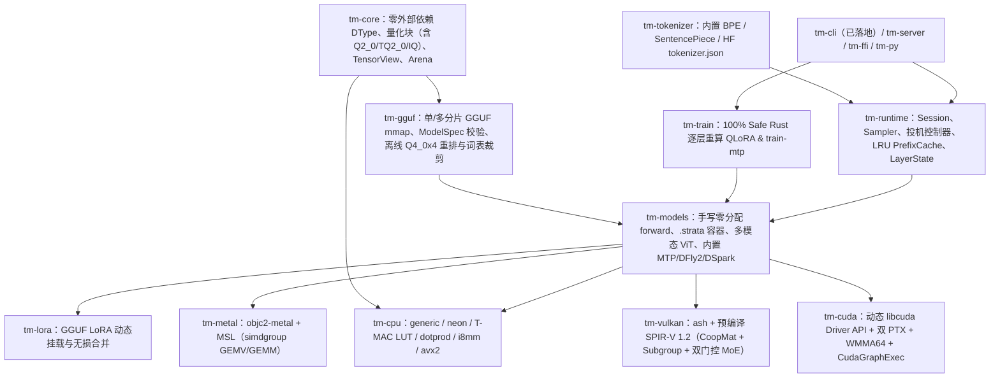

# 架构设计（Architecture）

> 状态：v0.2（已同步 M1–M4、T1–T4、M5 CUDA `ADR-026` 与 M6 多模态 / 稀疏 MoE 实装架构）。需求见 `REQUIREMENTS.md`，决策记录见 `DECISIONS.md`，环境变量见 `SETTINGS.md`。

## 1. 核心原理

- **decode 受内存带宽限制**：每个 token 的耗时 ≈ 要读取的字节数 ÷ 有效带宽。提速手段只有两类：**少读字节**（低比特量化、融合 `Gate+Up+Act` 单遍读输入、矩阵吸收式 28.4× 潜变量 MLA、PLE 按需单行 `mmap`、热专家 VRAM 缓存），或者**一次读取分摊给多个 token**（MTP / `DFly2` / `DSpark` / Suffix 投机解码 + 多步 `CudaGraphExec` 验证）。
- **prefill 受算力限制**：靠零膨胀重排微内核（`Q4_0x4`）、矩阵指令（`dotprod` / `i8mm` / `AVX2` / Metal `simdgroup_float8x8` / Vulkan `CoopMat` / CUDA `WMMA64` Tensor Core）与寄存器驻留批扫描（GDN）提速。
- **手写确定性模块优于通用计算图**：每个模型结构采用手写零堆分配 forward 与独立激活重算 QLoRA 反向，既消除图调度开销，也严格保障逐位确定性。

## 2. 分层



## 3. Crate 结构（Cargo workspace）

```text
tinymodel/
├─ Cargo.toml                 # workspace；profile 与后端 feature 定义
├─ crates/
│  ├─ tm-core/                # 零外部依赖：DType、量化块结构、TensorView、Arena、错误类型
│  ├─ tm-gguf/                # GGUF（含 -NNNNN-of-MMMMM 多分片）mmap、张量表校验、重排与词表裁剪
│  ├─ tm-cpu/                 # CPU 内核；按 ISA 从宽到窄自动注册分派 + TM_FORCE_ISA 降档
│  │  ├─ src/generic/         # 标量参考实现（L1 逐位真值来源）
│  │  ├─ src/aarch64/         # ARMv8.0 NEON + 16 行 T-MAC vqtbl1q 查表 / dotprod / i8mm asm!
│  │  ├─ src/x86_64/          # AVX2 + FMA（含 Q4_0 / Q8_0 / K-quant / Q2_0 / Mamba-2 scan）
│  │  └─ src/{isa,registry,pool}.rs   # 拓扑探测、大核绑核、epoch-CAS 线程池
│  ├─ tm-metal/               # Apple Metal 后端（零拷贝共享缓冲、MTLResidencySet、反向转置 GEMM）
│  ├─ tm-vulkan/              # Vulkan 1.2 后端（零 SDK 预编译 SPIR-V、CoopMatF16/I8、原生 Q2_0、双门控 MoE）
│  ├─ tm-cuda/                # NVIDIA CUDA 后端（动态 libcuda.so FFI、compute_75/80 双 PTX、CudaGraphExec、
│  │                          #   WMMA64 Tensor Core、异构双门控 MoE、吸收式 MLA、DDR 卸载 + 热专家 VRAM 缓存）
│  ├─ tm-lora/                # #![forbid(unsafe_code)] GGUF LoRA 推理叠加与离线无损合并
│  ├─ tm-models/              # 稠密（llama/qwen2/qwen3/smollm3/phi3/mistral/olmo2/granite/exaone）、
│  │                          #   混合（qwen35/gemma2-4/lfm2-3/mamba2）、稀疏 MoE（9 架构 + inkling2 + qwen4exp + hy4）、
│  │                          #   多模态视觉编码器（vision.rs）与神经草稿头（nextn MTP / qwen4exp-mtp / DFly2 / DSpark）
│  ├─ tm-train/               # #![forbid(unsafe_code)] 手写逐层激活重算 QLoRA 与 MTP 训练
│  ├─ tm-runtime/             # Session、LayerState、Sampler、spec.rs、prefix_cache.rs
│  ├─ tm-tokenizer/           # GPT-2/Qwen/DeepSeek3 Byte-BPE、LlamaSpm、Gemma4 SPM-BPE、HF JSON 加载器
│  └─ tm-cli/                 # run / bench / convert / finetune / train-mtp / lora-merge / probe
├─ tools/                     # Python FP64 oracle、logits_diff.py、quant_quality.py、LEGO DRC 微调流水线
├─ bench/                     # 基准协议、device_harness.py（ADB/SSH/Local）、基线与实测报告
├─ website/                   # 零构建依赖纯静态双语项目官网
└─ docs/
```

## 4. 编译配置与 features

| Profile | Cargo features | 目标三元组 / 典型产物 |
|---|---|---|
| `micro` | `--no-default-features --features micro` | `aarch64-unknown-linux-musl`（纯 ARMv8.0 NEON + LUT，静态 ELF `1.18–1.25 MiB`） |
| `edge` | `--features edge`（可选 `,vulkan`） | `aarch64-unknown-linux-{gnu,musl}`、`aarch64-linux-android` |
| `host` | `--features metal` / `vulkan` / `cuda` / `train` | `aarch64-apple-darwin`、`x86_64-unknown-linux-gnu` |

发布配置：`panic = "abort"`、`lto = "fat"`、`codegen-units = 1`、`strip = true`。`unsafe` 严格隔离在 `tm-cpu`、`tm-metal`、`tm-vulkan`、`tm-cuda`、`tm-ffi` 与 `tm-gguf`（仅限 `mmap`），且每处均附 `// SAFETY:` 证明。

## 5. 关键设计

### 5.1 张量、容器与零堆分配内存
- **零拷贝映射与流式上云**：GGUF（含自动发现的 `-NNNNN-of-MMMMM.gguf` 多分片）以只读 `mmap` 映射；`.strata` v1 六段式页对齐容器通过 `64 MiB` 双缓冲 `CudaPinnedBuffer` + `cuMemcpyHtoDAsync_v2` 异步流式灌入显存，主机常驻开销 `< 512 MiB`。
- **按张量自身 dtype 分派**：严禁假设同一层或跨层张量同量化格式；MoE 支持异构 `(gate_dtype, up_dtype)` 单遍融合内核。
- **Arena**：加载时按几何参数和最大上下文一次性切好 scratch 与状态缓冲；生成 token 的热路径上**零堆分配**。

### 5.2 LayerState（统一的每层状态与检查点）
- 统一管理全注意力 KV（`F16` / `Q8_0`）、滑动窗口环形 KV（SWA）、跨层共享 KV（`Gemma 4`）、压缩潜变量 MLA 缓存（`Hy4-Flash` `[cap, 576]` FP16，**压缩 28.4×**）、`DeltaNet`（`Qwen3.5/3.6/3.8` GDN `[H, S, S]` + 短卷积）、`ShortConv`（`LFM2/3`）以及 `Ssm`（`Mamba-2`）。
- **投机验证原子性**：递归状态在验证窗口内只读或保存设备端内联前向快照（`gdn_step_snap_batch_f32`），接受 `a` 个草稿 token 后零矩阵乘精确重放/拷贝恢复，保证投机开启前后贪心输出 **100% 逐位一致**。
- **前缀缓存（`PrefixCache`）**：受字节预算约束的 LRU 缓存；KV 支持任意最长公共前缀截断复用，GDN / ShortConv / SSM 递归状态通过精确检查点无损恢复。

### 5.3 CPU 内核
- 四档 ARM ISA（`generic` → `neon`［含 16 行二补数拆分 `vqtbl1q` T-MAC 查表］ → `dotprod` → `i8mm` `asm!`）与 `x86_64` `AVX2` 运行时自动探测分派，全部和 `generic` **0-ULP 逐位一致**。
- 零体积膨胀离线重排 `Q4_0x4`（`tinymodel convert`，72B 超块原位 `mmap`），避免运行时重排导致内存翻倍。

### 5.4 GPU 后端
- **Metal（`tm-metal`）**：基于 `objc2-metal`，采用 `newBufferWithBytesNoCopy` 零拷贝共享内存、每次 dispatch 强制校验 `maxTotalThreadsPerThreadgroup`、码本常驻 `threadgroup` 内存，并提供 `simdgroup_float8x8` 7 格式转置反向 GEMM。
- **Vulkan（`tm-vulkan`）**：基于 `ash` + 预编译校验 SPIR-V 1.2（交叉编译零 Vulkan SDK 依赖）；支持 `16×16×16` `VK_KHR_cooperative_matrix`、Subgroup `8/16/32/64` 自适应与 Pi 5 `V3DV` 无 Shuffle 共享内存退回、原生零膨胀 `Q2_0` 以及省显存双门控融合 `moe_dual_gu_act.comp`。
- **CUDA（`tm-cuda`）**：零外部 crate 依赖动态加载 `libcuda.so` Driver API，构建期并行编译 `compute_75`（Turing）与 `compute_80`（Ampere / Ada / Hopper / Blackwell）双份 PTX + Ampere+ L2 持久化缓存窗口：
  - **预填充**：`MAX_CUDA_BATCH = 512`、无 bank 冲突 `WMMA_SMEM_STRIDE = 40` 向量化反量化、宽 N `wmma_gemm_mixed_64x64_f32`、稀疏 MoE 确定性专家分桶 `wmma_moe_grouped_f32`、`.strata` `S_K` Tensor Core 与寄存器驻留批 GDN；
  - **解码与图捕获**：4-warp `__dp4a` MMVQ、异构 `(gate_dt, up_dt)` 单遍 `moe_indexed_dual_gu_act_f32`、`Hy4` 512-CTA 多 token 共享权重吸收式 MLA，以及单步解码与多步投机验证全覆盖的 **`CudaGraphExec`（含 `verify_graphs`）**；
  - **跨层级 MoE 卸载与缓存**：支持三层 `VRAM + RAM + NVMe O_DIRECT`（`Inkling-2`）以及 `TM_CUDA_MOE_HOST_OFFLOAD` 零拷贝主机锁页 DDR 卸载配合 `TM_CUDA_MOE_CACHE_EXPERTS` 图捕获安全 GPU 频率老化热专家 VRAM 缓存。

### 5.5 投机解码体系
- 原生支持五类草稿源：零参数 4-gram `SuffixDrafter`、通用 `train-mtp` GGUF 头、`Qwen3.5/3.6` 内置 `blk.{L}.nextn.*` MTP、`Qwen3.8` 独立 `qwen4exp-mtp` GGUF（QSA+MoE）、`Hy4-Flash` 内置 5 层并行掩码 `DFly2`、以及 `Inkling-2` `DSpark`（`dflash`）分块草稿器。
- `SpecController` 自动测量当前模型单步解码基准耗时，在线追踪净吞吐增益；低于 5% 阈值自动熔断并零开销切回单图 `CudaGraphExec` 解码。

## 6. 服务层要点（M5 下一阶段）
- stop 串**在文本层判断**，并带回扣（holdback）机制（已在 `tm-runtime` 落地）。
- 工具调用解析器根据聊天模板选择（XML 形态还是 JSON 形态）；用语料驱动的切片测试。
- 请求生命周期写成状态机（排队、运行、取消、完成）；出现非有限 logits 时清空缓存。
