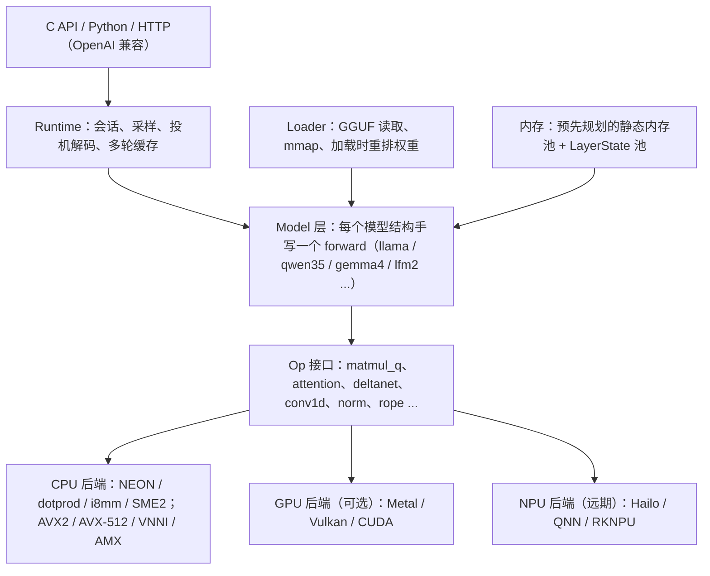

# 通用端侧推理引擎调研（分三档：Zero 2W ≤0.5B · 树莓派、手机 ≤5B · 主机 ≤8B）

> [!NOTE]
> 调研时间：2026-11。硬件数据来自公开测试；涉及模型架构的部分请以官方实现为准。

## 0. 结论先行

1. **生成阶段（decode）基本只受内存带宽限制**。在树莓派 5 上，llama.cpp 的生成速度已经接近带宽能达到的理论上限，所以单纯把计算内核写得更快，提速空间不大。真正能拉开差距的方向有三个：
   - **少读字节**：用更低比特的量化、对词表输出层（LM head）单独优化、利用 Gemma 4 的逐层嵌入（PLE）把部分权重放在存储里按需读取；
   - **用富余的算力换带宽**：投机解码、多 token 预测（MTP）；
   - **处理 prompt 的阶段（prefill）**：这一步受算力限制，现有引擎在这里离硬件上限还很远。
2. **≤5B 模型的结构已经不只是标准 Transformer 了**。Qwen3.5 混用了 Gated DeltaNet（一种线性注意力），LFM2 用了短卷积，Gemma 4 用了 PLE 和滑动窗口注意力，还有多模态编码器。引擎必须把“循环状态”和“KV cache”都当成一等公民来设计，不能只围绕 KV cache。
3. **建议的定位**：主力是 CPU（ARM 和 x86），GPU（Metal/Vulkan/CUDA）作为可选加速；模型文件兼容 GGUF，借用现成的模型生态；每种模型的计算图用代码手写，不做通用编译器；内核在运行时按 CPU 指令集选择最优版本。

---

## 1. 目标硬件的理论上限（第一性原理）

### 1.1 硬件档位

| 档位 | 代表硬件 | 实测内存带宽 | CPU 特性 | 可选加速器 |
|---|---|---|---|---|
| 高端主机 | x86 台式机 + 独显 | DDR5 双通道约 60–80 GB/s；显卡 200–1000 GB/s | AVX2 / AVX-512 / VNNI / AMX | CUDA、Vulkan |
| Apple 芯片 | M4（你当前的机器，16GB） | 约 120 GB/s | NEON、dotprod、i8mm、SME2 | Metal |
| 中端开发板 | Jetson Orin Nano、RK3588 | 约 30–100 GB/s | A78 / A76 | CUDA / Mali（Vulkan） / RKNPU |
| **树莓派 5** | BCM2712，4 核 Cortex-A76，2.4GHz | **约 11.5 GB/s**（STREAM 测试） | NEON、**dotprod**、FP16；**不支持 i8mm、SVE** | VideoCore VII（Vulkan，性能弱）、AI HAT+ 2（Hailo-10H） |
| 树莓派 4 | 4 核 Cortex-A72 | 约 5.5 GB/s | 只有 NEON（**没有 dotprod**，也不支持 FP16 运算） | 无 |

### 1.2 生成速度上限 ≈ 有效带宽 ÷ 每个 token 需要读取的字节数

按约 4.5 bit/权重（Q4_0 级别）估算，有效带宽取实测值的 80%：

| 模型 | 每 token 读取量 | 树莓派 4 | 树莓派 5 | 台式机 DDR5 | M4 |
|---|---|---|---|---|---|
| 0.8B | 约 0.45 GB | 约 10 tok/s | 约 20 | 约 120 | 约 210 |
| 1B | 约 0.6 GB | 约 7 | **约 15**（实测 10–14） | 约 90 | 约 160 |
| 3B | 约 1.8 GB | 约 2.4 | **约 5**（实测 4.5–7） | 约 30 | 约 53 |
| 4.5B | 约 2.5 GB | 约 1.7 | 约 3.7 | 约 22 | 约 38 |

> [!IMPORTANT]
> 实测值已经达到理论上限的 70–90%。所以要在树莓派上明显超过 llama.cpp，必须减少每个 token 读取的字节，或者把一次读取分摊给多个 token。只优化计算内核做不到。

### 1.3 Prefill 上限（受算力限制）

- 树莓派 5 的粗略峰值：FP32 约 150 GFLOPS，INT8 dotprod 约 600 GOPS。按 1B 模型每 token 约 2 GFLOP 计算，理论可达约 300 tok/s，**实测只有 70–90 tok/s**，还有 3 倍左右的空间。
- 这个空间会直接影响首 token 延迟（TTFT），在 RAG 和长 prompt 场景尤其明显，是比较适合追求“打败 llama.cpp”的方向。

---

## 2. 现有引擎：分别值得借鉴什么

| 引擎 | 核心思路 | 值得借鉴 | 不要照搬 |
|---|---|---|---|
| **llama.cpp / ggml** | 纯 C/C++ 张量库 + GGUF 格式 + 多种计算后端 | GGUF 格式和模型生态；K-quant、IQ 系列量化；ARM 上加载时重排权重（KleidiAI：SME2 → i8mm → dotprod 逐级回退）；mmap 加载 | 通用计算图每步都要动态重建，有额外开销；代码庞大，新增一种模型结构要改很多地方 |
| **MLC-LLM** | 基于 TVM 的提前编译（AOT） | 自动调优内核；支持 WebGPU | 编译链太重，换模型就得重新编译 |
| **ExecuTorch** | `torch.export` 导出 + 把算子交给不同后端（delegate） | 统一了 NPU 接入方式（QNN、CoreML）；XNNPACK 作为 CPU 后端 | 被 PyTorch 导出流程绑死，非标准算子很难导出 |
| **MNN-LLM**（阿里） | 移动端轻量运行时 | 程序体积小；内存精细管理；ARM 内核很强 | 生态相对封闭 |
| **LiteRT-LM**（Google） | TFLite 体系 + 只针对 Gemma 深度优化 | PLE 通过 mmap 按需读取；MTP 草稿模型和主模型在同一设备上执行；XNNPACK + ML Drift | 主要服务自家模型 |
| **MLX** | Apple 统一内存 + 延迟计算 | Metal 内核写法；量化矩阵乘 | 只能在 Apple 上用 |
| **T-MAC / bitnet.cpp** | 用查表（LUT）代替乘法，适合低比特 | **在树莓派 5 上跑 BitNet-3B 达到约 11 tok/s**；内核比 llama.cpp 快约 3.6 倍，能耗降低 60–70% | 只对 1–4 bit 权重有优势 |
| **Strata**（你工作区里的 `Strata/`） | 基于 ggml 的大模型（35B MoE）引擎，CUDA/HIP/Metal/SYCL | 已经有 GGUF 读取器（`src/artifact/`）、Qwen3.5 的实现（`src/qwen35/`）、MTP、n-gram 投机解码、Metal 内核，可以对照着看 | 面向桌面显卡和大模型，不支持树莓派那类低端 CPU |

---

## 3. ≤5B 模型需要支持的结构和算子

| 结构类别 | 代表模型 | 需要的算子和状态 |
|---|---|---|
| 标准 Transformer（GQA） | Llama 3.2、Qwen3、Phi-4-mini、SmolLM3 | RMSNorm、RoPE（含 YaRN 等长上下文缩放方案）、GQA 注意力、SwiGLU；KV cache |
| 滑动窗口 + 全局注意力交替 | Gemma 3 / 4 | 滑动窗口 mask、环形 KV cache、soft-capping、QK-norm |
| **PLE + MatFormer** | Gemma 3n / 4 E2B / E4B | 逐层嵌入从存储按需读取；KV 在层间共享；AltUp / Laurel 等专有模块 |
| **线性注意力混合（3:1）** | **Qwen3.5** 0.8B–9B | Gated DeltaNet 的分块并行扫描（prefill 用）和单步递推（decode 用）；短卷积；带输出门控的全注意力层；**固定大小的循环状态** |
| 短卷积混合 | LFM2 / LFM2.5 | 带门控的 1D 短卷积（需要保存卷积状态）+ GQA |
| SSM 混合 | Mamba2 类（Granite 4、Falcon-H1 等） | selective scan，保存 SSM 状态 |
| 多模态编码器 | Qwen3.5-VL、Gemma 4、MiniCPM-V | ViT（支持动态分辨率）、Conformer 音频编码器、投影层 |
| 极低比特 | BitNet b1.58 | 三值权重的查表矩阵乘 |

**设计上的结论**：每层的状态要抽象成统一的 `LayerState`，同时覆盖 KV cache、DeltaNet/SSM 的状态矩阵和卷积缓存。这样做的直接好处是：
- 多轮对话缓存、会话快照、投机解码失败后的回滚，都可以只写一套逻辑；
- 混合模型的回滚不能像 KV cache 那样直接截断，必须靠**状态快照**或**重新计算**来实现。

---

## 4. 架构方案

### 关键设计选择

| 方面 | 建议 | 理由 |
|---|---|---|
| 实现语言 | C++17/20 核心 + C ABI；尽量不依赖第三方库 | 方便交叉编译到树莓派，程序可以做到 1–3 MB |
| 计算图 | **每种模型手写 forward**；预先规划好内存，执行时不分配内存 | ≤5B 的模型结构种类有限，手写最快、最好调试；也避免了 ggml 那种动态建图的开销 |
| 模型格式 | **直接读 GGUF**（必要时加扩展元数据） | 白拿 Hugging Face 上大量现成的量化模型和 llama.cpp 的转换工具 |
| 加载 | mmap + **加载时把权重重排成内核需要的布局**（可缓存到磁盘） | 树莓派用 SD 卡或 eMMC 时，冷启动很慢，需要单独优化 |
| 指令集选择 | 同一个二进制里编译多个版本，**运行时检测 CPU 特性**后选用 | 一个包就能覆盖树莓派 4、树莓派 5、M4、x86 |
| 线程 | 自己写线程池，同步用自旋等待加短暂休眠；识别大小核；**decode 时可以少用线程** | 在树莓派上，从 3 线程增加到 4 线程收益很小，反而更容易过热降频 |
| 会话 | 多轮对话复用前缀缓存；会话状态可以落盘或恢复 | 适合端侧 Agent 的常驻场景 |

---

## 5. 按收益排序的优化项

### 生成阶段（受带宽限制）
1. **激活值动态量化成 INT8，权重 4 bit，用 dotprod/i8mm 做整数点积**。这是基本要求；树莓派 4 没有 dotprod，需要单独写 NEON 回退路径。
2. **单独优化 LM head**：小模型的词表很大（151k–262k），输出层可能占到每 token 读取量的 20–35%。可选手段：
   - 输出层单独用更低比特量化；
   - 先粗筛候选词再精算（top-k 预筛选）；
   - 投机解码时只对草稿 token 计算完整的 logits。
3. **投机解码**：MTP 头（Gemma 4、Qwen 等模型自带）、n-gram 或 prompt 查找（基本零成本）、小草稿模型。树莓派在生成阶段算力有富余，一次验证 k 个 token，读取的字节数几乎不变。
4. **更低比特量化**：Q3/Q2/IQ 系列、三值量化 + 查表内核（参考 T-MAC）。对 ≤5B 模型掉点明显，需要配合 imatrix 或 QAT 等校准手段。
5. **KV cache 量化**（Q8/Q4）+ 混合模型状态管理：长上下文时 KV 的读取会超过权重本身。
6. **PLE 按需读取**：Gemma 4 E2B 总参数 5.1B，实际有效只有 2.3B，必须实现这一点才能在 4GB 内存的树莓派上运行。

### Prefill 阶段（受算力限制）
1. 分块 GEMM 微内核（参考 KleidiAI 和 XNNPACK），重排后的权重布局让缓存命中率更高。
2. 注意力用 flash 式的分块计算；DeltaNet 用分块并行扫描。
3. x86 上使用 AMX/VNNI，Apple 上使用 SME2；树莓派只能靠 dotprod 用到极致。
4. 主机上把 prefill 交给 GPU，decode 留给 CPU 或 GPU（可选）。

---

## 6. 量化格式建议

| 格式 | 用途 |
|---|---|
| Q8_0（每 32 个一组） | 激活值、KV cache、需要高精度的层 |
| **Q4_0 + 重排布局**（主力格式） | ARM 上最容易写出最优内核；和 KleidiAI 路线一致 |
| Q4_K / Q5_K / Q6_K | 兼容社区现有的 GGUF 文件（加载时转换成内部布局） |
| IQ2 / IQ3、三值 | 树莓派 4 或 2–4GB 内存设备的极限场景 |
| GPTQ / AWQ 按组 INT4 | 从 Hugging Face 的 safetensors 直接导入 |

---

## 7. 路线图

| 阶段 | 内容 | 验收标准 |
|---|---|---|
| **M0：基线**（1–2 周） | 在 M4 和树莓派 5 上用 llama.cpp 测 Llama 3.2 1B/3B、Qwen3.5 0.8B/2B/4B、Gemma 4 E2B，记录 prefill、decode、内存峰值、功耗 | 有一份可复现的基线表格 |
| **M1：最小可用版本**（4–6 周） | GGUF 加载 + Llama/Qwen3 的 forward + CPU 内核（NEON/dotprod/AVX2）+ 贪心解码和采样 | 输出和 llama.cpp 逐 token 一致；树莓派 5 的 decode 速度不低于 llama.cpp 的 95% |
| **M2：新结构** | Qwen3.5（Gated DeltaNet）、Gemma 4（PLE、滑动窗口）、LFM2；统一的 `LayerState` | 困惑度和 logits 与参考实现对齐 |
| **M3：性能** | prefill GEMM 微内核、LM head 优化、n-gram 和 MTP 投机解码、KV 量化 | 树莓派 5 的 **prefill 达到 llama.cpp 的 1.5–2 倍，有效 decode 达到 1.3 倍以上** |
| **M4：加速器** | Metal → Vulkan → CUDA；多模态编码器 | M4 上 decode 速度达到 MLX 的 90% 以上 |
| **M5：生态** | OpenAI 兼容服务、Python 绑定、Hailo/RKNPU 实验性支持 | — |

---

## 8. 需要你拍板的决策

| 决策 | 选项 | 我的建议 |
|---|---|---|
| **A. 自研到什么程度** | ① fork llama.cpp 做裁剪和定制；② **自研运行时和模型层，兼容 GGUF，借鉴 ggml/KleidiAI 的内核**；③ 全部从零写，包括自定义格式 | ②：既能掌控架构，又不用重新建模型生态 |
| B. 首要优化的硬件 | 树莓派 5 / Apple / x86 | 先树莓派 5（最受约束，最能体现价值），M4 用来开发和调试 |
| C. 首批支持的模型 | Llama/Qwen3 → Qwen3.5 → Gemma 4 | 照这个顺序 |
| D. GPU 后端 | Vulkan 一套覆盖所有平台 / 每个平台用原生 API | 先 Metal（你手上有 M4），再 Vulkan |
| E. 是否支持树莓派 4 / Pi Zero 2W | 支持 / 不支持 | 树莓派 4 只提供 NEON 回退路径，不专门优化；Pi Zero 2W（512MB 内存）只考虑 ≤0.5B 的模型 |

## 8.5 附：树莓派 Zero 2W 档（单独的“微型”配置）

| 项目 | Zero 2W | 对比树莓派 5 |
|---|---|---|
| CPU | 4 核 Cortex-A53，1GHz，**顺序执行**，ARMv8.0，只有 NEON（**没有 dotprod，不支持 FP16 运算**） | A76，2.4GHz，乱序执行 |
| 内存 | **512MB LPDDR2**，系统已占用约 100–150MB，**实际可用约 350MB** | 4–16GB |
| 带宽 | **实测约 1.5–2.2 GB/s** | 约 11.5 GB/s（是 Zero 2W 的 6–7 倍） |
| 算力 | FP32 峰值约 16 GFLOPS | 约 150 GFLOPS |

**生成速度上限**（有效带宽按约 1.6 GB/s 计算）：

| 模型 | 量化后大小 | 能否装进内存 | 理论生成速度 |
|---|---|---|---|
| SmolLM2-135M | Q8 约 145MB / Q4 约 85MB | ✅ | 约 10 / 约 18 tok/s |
| Gemma 3 270M | Q4 约 240MB（**词表 262k，嵌入层约占 60%**） | ✅ | 约 6 tok/s |
| LFM2-350M | Q4 约 230MB（词表只有 65k） | ✅ | 约 7 tok/s |
| SmolLM2-360M | Q4 约 230MB | ✅ | 约 7 tok/s |
| Qwen3-0.6B | Q4 约 380MB | ⚠️ 很勉强，需要 IQ3 量化 | 约 4 tok/s |
| Qwen3.5-0.8B / Llama 1B 及以上 | ≥ 500MB | ❌ 装不下，权重会被换出到 SD 卡（约 50MB/s），速度会掉到每秒 1 个 token 以下 | — |

**这一档对引擎的额外要求**：
1. **内存零拷贝**：直接用 mmap 映射的权重计算，加载时重排权重会多占一份内存，必须改为离线重排；内存池预先规划好；上下文限制在 2k 左右；KV cache 用 Q8；不用 Python，程序体积控制在 1MB 以内。
2. **为 ARMv8.0 专门写内核**：没有 dotprod，INT8 只能用 `SMULL`/`SMLAL`/`SADALP` 组合；也可以用 **`TBL` 查表**（T-MAC 路线），这在 A53 上特别划算。A53 是顺序执行，需要手动排指令顺序、加软件预取。
3. **对 LM head 和嵌入层动刀**：这一档词表对速度和内存的影响最大。模型转换时**可选裁剪词表**（比如只保留中英文常用的 32k token）；嵌入表只读取用到的行。
4. **系统配置**：64 位 Lite 系统；GPU 显存设到最小；用 zram 而不是 SD 卡做 swap；加散热片，防止 1GHz 降频。
5. **定位**：适合跑**针对特定任务微调的 100–350M 模型**，比如意图识别、指令解析、分类、简短回复，或者作为瘦客户端，把复杂请求转给主机处理。不适合通用聊天。

## 8.6 附：高性能主机档（≤8B）

### 硬件与理论上限（以 8B 模型、Q4 量化约 4.7GB 为例）

| 主机 | 带宽 | 8B Q4 理论生成速度 | 备注 |
|---|---|---|---|
| x86 台式机，只用 CPU（DDR5 双通道） | 约 70 GB/s | 约 12 tok/s | prefill 依赖 AVX-512、VNNI、AMX |
| **M4（16GB，你的机器）** | 约 120 GB/s | 约 20 tok/s | 16GB 统一内存，Q8（约 8.5GB）也放得下 |
| M4 Pro / M4 Max | 273 / 546 GB/s | 约 45 / 约 90 tok/s | — |
| RTX 4060 8GB | 272 GB/s | 约 45 tok/s | 显存紧张：Q4 加上 KV cache 约 6–7GB |
| RTX 4090 / 5090 | 1.0 / 1.8 TB/s | 约 170 / 约 300 tok/s | RTX 50 系列可以考虑 FP4 |

### 需要支持的 5–8B 模型
- **稠密模型**：Llama 3.1 8B、Qwen3-8B、Qwen3.5-9B（略超 8B，建议也算在内）、Granite 4（混合了 Mamba2）、MiniCPM-V 8B（多模态）。
- **“总参数大、实际计算量小”的模型**：Gemma 4 E4B（总参数 8B）、**小型 MoE**，例如 LFM2-8B-A1B（每 token 只激活约 1B 参数）。⚠️ 具体型号请以发布时的情况为准。

### 和小模型档相比，引擎多出来的要求
1. **GPU 后端从“可选”变成“必须”**：先做 Metal 和 CUDA，再用 Vulkan 覆盖 AMD 和 Intel 显卡。
   - decode 需要量化后的矩阵向量乘（GEMV）内核；
   - prefill 需要能用上 Tensor Core 或 simdgroup 的量化矩阵乘（MMQ）内核；
   - 注意力用 flash attention；Gated DeltaNet 和 SSM 需要 GPU 版本的扫描内核。
2. **KV cache 成为主要的内存开销**：Llama 3.1 8B 的 KV cache 在 FP16 下每 token 约 128KB，**32k 上下文约 4.3GB**，和权重差不多大。需要：
   - KV 量化（Q8/Q4）；
   - 分页 KV（paged KV）；
   - 前缀缓存；
   - 混合结构模型（如 Qwen3.5）在这里有天然优势。
3. **CPU 和 GPU 混合执行**：显存不够时，按层把一部分放到 CPU 上算；MoE 模型可以把专家权重放在 CPU 或内存里，常用的专家缓存在显存中。
4. **投机解码收益最大**：同一系列的小模型当草稿模型（比如用 Qwen3.5-0.8B 给 9B 打草稿），或者用模型自带的 MTP 头。主机算力富余，常见能提速 1.5–2.5 倍。
5. **少量并发**：主机上可能同时跑多个应用或 Agent，需要能同时处理 2–8 条请求、连续批处理（continuous batching），并提供 OpenAI 兼容服务。不需要做到 vLLM 那种服务器级别。
6. **更多数据类型**：BF16 和 FP16 原始权重；在新显卡上可选 FP8、FP4。

### 对整体架构的影响
同一份代码，按三种配置编译：

| 配置 | 目标 | 模型 | 后端 | 功能取舍 |
|---|---|---|---|---|
| `micro` | Zero 2W | ≤0.5B | 只有 ARMv8.0 NEON 和查表内核 | 只支持单条请求，零拷贝 |
| `edge` | 树莓派 5、手机、开发板 | ≤5B | CPU（dotprod/i8mm）+ 可选 Vulkan | 投机解码、KV 量化 |
| `host` | 台式机、Mac | ≤8B（可延伸到 9B） | CPU + **Metal / CUDA / Vulkan** | 混合执行、分页 KV、多条并发、草稿模型 |

模型层（每个结构的 forward）和 `LayerState` 在三档之间共用，只有后端和功能开关不同。**路线图调整**：Metal 后端提前到 M2 阶段（你的主力开发机就是 M4），CUDA 放到 M3 阶段。工作区里的 `Strata/` 有现成的 CUDA、HIP、Metal 内核和专家缓存实现，这一档参考价值更高。

## 9. 风险

- **模型结构更新太快**：每个新模型都要手写 forward。缓解办法是用 Python 参考实现自动比对 logits，并写好一套“新增模型结构”的模板。
- **低比特量化掉点**：≤5B 模型对量化很敏感，需要配一套评测（困惑度 + 几项下游任务）。
- **树莓派过热降频**：测速时必须装主动散热，同时记录温度和频率。
- **NPU 碎片化**：Hailo、QNN、RKNPU 各有一套工具链，建议放到最后一个阶段，只做实验性支持。
