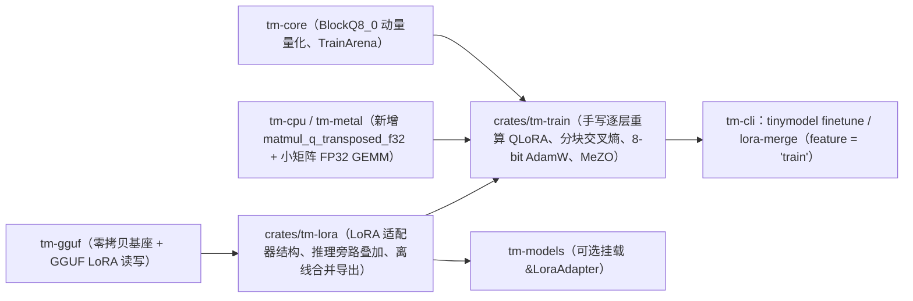

# 利用 `tinymodel` 引擎实现端侧小模型微调技术调研

> 日期：2026-11-20  
> 关联文档：[REQUIREMENTS.md](../REQUIREMENTS.md)、[ARCHITECTURE.md](../ARCHITECTURE.md)、[DECISIONS.md](../DECISIONS.md)

---

## 1. 背景与核心洞察：为什么 `llama.cpp` 放弃了内置微调，而 `tinymodel` 反而适合？

2024 年 `llama.cpp` 正式移除了内置的 `llama-finetune`（PR #8669）。复盘其失败根因与近年端侧训练系统（Karpathy `llm.c`、MIT `PockEngine`、Meta `ExecuTorch`、Apple 端侧 Adapter 训练）的成功经验，可以得出一个反直觉但关键的工程结论：

1. **`llama.cpp` 失败在“试图维护一套通用动态图自动微分（`ggml-opt`）”**：
   - 每当推理端升级 FlashAttention、GQA 或新增混合结构，通用反向计算图的节点推导与张量生命周期规划就会断裂；
   - 未做**分块融合交叉熵（Chunked Cross-Entropy）**与**逐层激活重算（Layer Checkpointing）**，在大词表模型上仅 `logits + d_logits` 就吃掉近 1 GiB 内存。
2. **`tinymodel` 的 `ADR-004`（手写 Forward + 静态 Arena + 零拷贝 `mmap`）天然契合端侧 QLoRA**：
   - ≤8B 端侧模型的层结构高度收敛（标准 `RMSNorm + RoPE + GQA + SwiGLU`，以及 Qwen3.5 的 `Gated DeltaNet`）；
   - 正如 `llm.c` 证明的那样，**为固定层模板手写对称的 `backward_layer` + 静态训练 Arena**，无需任何动态图框架，代码量仅数千行纯安全 Rust，内存占用可精确控制在字节级且比 PyTorch 低 **4×–6×**；
   - 基座权重已通过 [tm-gguf](../../crates/tm-gguf/src/lib.rs) 以只读 `mmap` 映射（在 macOS Metal 上甚至与 GPU 零拷贝共享物理页），训练全程**基座权重 0 脏页拷贝**。

---

## 2. 四条技术路线对比（按硬件档位与任务复杂度选型）

利用现有推理引擎能力实现微调，共有四条由轻到重的技术路径：

| 维度 | **L0：GGUF LoRA 动态加载/合并** | **L1：零阶微调（MeZO / ZO-LoRA）** | **L2：顶层 / 稀疏反向（Last-$K$ / MTP 头）** | **L3：手写逐层重算 QLoRA（推荐主力）** |
|---|---|---|---|---|
| **是否需要写反向算子** | 否（纯推理挂载云端/主机训好的 LoRA） | **否（100% 复用现有 `forward_batch`）** | 仅最后 $K$ 层或独立输出头 | 是（手写对称 `backward_layer`） |
| **新增核心内核** | 旁路小矩阵乘 $B(Ax)$ | 伪随机种子原地扰动 + Cross-Entropy | 顶层 FP32/量化转置矩阵乘 | **量化转置矩阵乘 $dY \cdot W_q$** + 分块交叉熵 |
| **额外脏内存（0.8B, $T=512$）** | **~12 MiB** | **~15 MiB**（与纯推理几乎相同） | **~35 MiB**（前 $L-K$ 层特征可缓存复用） | **~125 MiB**（含 8-bit AdamW + 激活检查点） |
| **收敛速度与精度** | 取决于外部训练 | 慢 **10×–30×**，仅限极低秩（$r \le 4$） | 快（前 $L-K$ 层仅首轮算一次！） | **与 PyTorch / Unsloth QLoRA 等价** |
| **适用硬件档位** | `micro` / `edge` / `host` 全档 | `micro`（Zero 2W / 1GB Pi 4B）极小样本校准 | `micro` / `edge`（意图路由、**训练自身 MTP 投机头**） | **`edge`（≥2GB Pi 4B / Pi 5 / 手机）与 `host`（M4 / 独显）** |

### 各路线的典型应用场景
- **L1（MeZO 零阶优化）**：利用单随机种子 `seed` 执行 $\theta \pm \epsilon z$ 两次前向求 $(L_+ - L_-)/(2\epsilon)$，无需存任何中间激活，连 `Q4_0`/`Q5_K`/`Q6_K` 混合量化和 GDN 层都无需写反向即可调参。但梯度方差随可训练参数数线性增长，仅适合 **$r=1..2$ 的超低秩风格微调或 Prompt Tuning**。
- **L2（稀疏反向 + 引擎自举加速）**：冻结前 $80\%$ 层（用现有推理引擎算一次特征缓存在内存/SSD），仅训练最后 2–4 层或 **MTP（Multi-Token Prediction）投机草稿头**。这还能反哺推理引擎自身的 **F-12 投机解码**——在用户的树莓派/Mac 本地代码或业务语料上花几分钟微调一个几十 MB 的 MTP 头，直接提升本地投机接受率与解码速度！
- **L3（手写逐层重算 QLoRA）**：真正解决通用指令微调、Function Calling 格式对齐、垂直领域知识注入的**一等公民方案**。

---

## 3. 主力方案（L3：引擎原生手写 QLoRA）的四大关键技术设计

在冻结的 GGUF 量化权重 $W_q \in \mathbb{Q}^{d_{\text{out}} \times d_{\text{in}}}$ 上挂载可训练低秩矩阵 $A \in \mathbb{R}^{r \times d_{\text{in}}}$、$B \in \mathbb{R}^{d_{\text{out}} \times r}$（缩放 $s = \alpha / r$）：

- **前向**：
  $$Y = \underbrace{X W_q^\top}_{\text{现有 matmul\_f32}} + s (X A^\top) B^\top$$
- **反向**（给定上游梯度 $dY \in \mathbb{R}^{T \times d_{\text{out}}}$，记 $H_{\text{lora}} = X A^\top \in \mathbb{R}^{T \times r}$）：
  $$dB = s \cdot dY^\top H_{\text{lora}}, \qquad dH_{\text{lora}} = s \cdot dY B, \qquad dA = dH_{\text{lora}}^\top X$$
  $$dX = \underbrace{dY \cdot W_q}_{\text{新增：免转置拷贝量化矩阵乘！}} + dH_{\text{lora}} \cdot A$$

要让这套流程在 2GB 树莓派到 16GB M4 上都跑得飞快且不爆内存，需攻克以下四个核心点：

### 3.1 零拷贝量化转置算子（`matmul_q_transposed`：$dX = dY \cdot W_q$）
- **难点**：GGUF 的 `BlockQ4_0` / `BlockQ5K` / `BlockQ6K` 是沿输入列维 `d_in`（每 32 或 256 个元素共享 scale）打包的。前向算 $X W_q^\top$ 是顺着量化块做**点积**；而反向算 $dX = dY \cdot W_q = \sum_i dY_{:, i} (W_q)_{i, :}$ 是顺着量化块做**标量缩放累加（Vector-Block AXPY）**。
- **严禁离线转置或反量化整张权重表**（否则 0.8B/2B 模型内存立涨 4 倍）。
- **零拷贝实现**：
  - **CPU (`tm-cpu`)**：按输出行分块 $i \in [i_0, i_0 + 32)$、列量化块 $b$ 遍历只读 `mmap` 中的 $W_q$；在 L1D 缓存内将 `32 × 32` 的量化块即时反量化为 `4 KB` FP32 微块，与 $dY_{:, i_0..i_0+32}$ 做 NEON / AVX2 FMA 累加到 $dX_{:, 32b..32(b+1)}$。注意：由于 $dY$ 动态范围跨数量级，**反向激活梯度必须保持 FP32/FP16 浮点乘加，不能像前向那样量化为 `Q8_0`**。
  - **Metal (`tm-metal`)**：每个 Threadgroup 将 `32 × 32` 量化权重块解包至 `threadgroup half shared_w[32][32]`，直接调用 Apple GPU 硬件 `simdgroup_multiply_accumulate` 与 `dY` 瓦片相乘，**100% 复用零拷贝 `MTLBuffer` 权重**。

### 3.2 分块融合交叉熵（Chunked Fused Cross-Entropy）——砍掉 98% 词表峰值内存
- **头号内存陷阱**：`Qwen3.5` 词表 $V = 248,320$。若一次算出序列长 $T = 512$ 的完整 `logits` 与 `d_logits`（FP32），仅此一项就需 $512 \times 248320 \times 4 \times 2 = \mathbf{970\text{ MiB}}$，直接打爆端侧内存！
- **解法**：沿 token 维以微块 $T_{\text{chunk}} = 16$ 循环：
  1. 算局部 `logits_chunk`（`16 × 248,320 × 4B = 15.1 MiB`）；
  2. Online Softmax 计算交叉熵损失，并**原地覆写** `logits_chunk[t, v] = p[t, v] - 1_{v == y_t}`；
  3. 立即乘回 `lm_head`（`dH_chunk = logits_chunk · W_lm_head`）写入 `[T, d_model]`（仅 `2.0 MiB`）。
- **收益**：词表侧峰值内存从 **`970 MiB` 压降至 `15.1 MiB`（减少 98.4%）**，且算术结果与全量计算**逐位等价**。

### 3.3 逐层激活检查点（Per-Layer Checkpointing）+ 静态 `TrainArena`
- 前向遍历 $0 \dots L-1$ 层时，**仅缓存每层入口的 `FP16`/`BF16` 残差张量 $X^{(l)} \in \mathbb{F}_{16}^{T \times d_{\text{model}}}$**，中间的 `Q/K/V`、注意力矩阵、`SwiGLU` 门控值全部丢弃。
- 反向遍历第 $l$ 层时：从检查点读出 $X^{(l)}$，在**单层共享的静态 `TrainArena`** 内重算第 $l$ 层前向中间量（代价仅相当于多做 1 次前向，总计算量约为推理 Prefill 的 `3×`），随即在同一块 `TrainArena` 内完成第 $l$ 层反向并 `reset()`。
- **GQA Attention 反向**：对于 $T \le 1024$ 的端侧微调序列，单层重算注意力矩阵仅为 $H_q \times T \times T \times 4\text{B}$（`Qwen3.5` $H_q=8, T=512 \Rightarrow \mathbf{8\text{ MiB}}$），在单层 `TrainArena` 内直接做标准 Softmax 反向即可，甚至无需复杂的 FlashAttention Backward。

### 3.4 Qwen3.5 混合线性注意力（Gated DeltaNet）的反向设计
Qwen3.5 的 18 层 GDN 递推：
$$S_t = \alpha_t S_{t-1} + \beta_t (v_t - \alpha_t S_{t-1} k_t) k_t^\top, \qquad o_t = S_t q_t$$
在反向传播上反而比长序列全注意力更规整：
1. **LoRA 挂载点**：仅挂载在线性投影矩阵（`attn_qkv`、`attn_gate`、`ssm_out`、`ffn_gate/up/down`）上，保持标量门参数 `ssm_a`、`ssm_dt.bias`、`ssm_conv1d` 冻结（或可选微调 `FP32` 1D 深度卷积核）。
2. **伴随状态递推（Adjoint Recurrence）**：单层重算时每 $C = 16$ 步保存一个状态快照 $S_{16k}$（`32 × 16 × 128 × 128 × 4B = 32 MiB`，或 $T=512$ 下仅在重算单层时使用），反向按 $t = T-1 \dots 0$ 逆序递推伴随矩阵 $dS_t \in \mathbb{R}^{S \times S}$：
   - 令 $e_t = v_t - \alpha_t S_{t-1} k_t$，则 $dS_t \leftarrow dS_{\text{next}} + q_t d o_t^\top$；
   - $de_t = \beta_t dS_t k_t$，$dv_t = de_t$，$dk_t = \beta_t dS_t^\top e_t - \alpha_t S_{t-1}^\top de_t$；
   - 向过去传递：$dS_{\text{prev}} = \alpha_t (dS_t - de_t k_t^\top)$。
   全程复杂度严格为 **$O(T \cdot S^2)$**，与前向递推完全同构！

---

## 4. 端侧微调精确内存账本与速度估算

以 **`Qwen3.5-0.8B-Q4_0`**（24 层，$d=1024, d_{\text{ff}}=3584, V=248320$，序列长 **$T = 512$**，全层线性投影挂载 **LoRA $r = 8$**，可训练参数约 **5.7M**）与 **`SmolLM2-360M-Q4_0`**（32 层，$d=960$，$r=8$，可训练参数约 **4.3M**）为例：

| 内存分项 | `SmolLM2-360M` ($T=512, r=8$) | `Qwen3.5-0.8B` ($T=512, r=8$) | 说明 |
|---|---:|---:|---|
| 基座权重（只读 `mmap` 干净页） | `219.0 MiB` | `484.0 MiB` | OS 页缓存按需映射，**0 脏内存** |
| LoRA 权重 (`FP32`) + 梯度 (`FP32`) | `32.8 MiB` | `43.6 MiB` | $A, B$ 与 $dA, dB$ 原地累加 |
| **8-bit Blockwise AdamW 状态 (`m, v`)** | **`8.8 MiB`** | **`11.6 MiB`** | 直接复用 [tm-core](../../crates/tm-core/src/dtype.rs) 的 `BlockQ8_0` 块量化存储动量！ |
| 每层入口激活检查点 $X^{(0..L)}$ (`FP16`) | `30.0 MiB` | `24.0 MiB` | $L \times T \times d \times 2\text{B}$ |
| 单层共享静态 `TrainArena`（含分块 CE） | `22.0 MiB` | `38.0 MiB` | 各层重算与反向完立即 `reset()` 复用 |
| 扁平池 Tokenizer | `3.5 MiB` | `8.0 MiB` | 已在 P2 中完成优化 |
| **运行时总脏内存（Dirty RAM）** | **`97.1 MiB`** | **`125.2 MiB`** | 远低于 PyTorch QLoRA 的 `1.5–2.5 GiB` |
| **全进程峰值 RSS（含 `mmap`）** | **`~316 MiB`** | **`~610 MiB`** | **2GB Pi 4B 即可跑 0.8B QLoRA；1GB Pi 4B 可跑 360M QLoRA！** |

### 各档硬件训练吞吐
> 吞吐的估算与修正见第 6 节。上一版按“3.2× Prefill”直接折算，没有考虑反向必须走 FP32/FP16 浮点、不能用 int8 点积，结果偏乐观约 1.5–2.5 倍，已作废。

---

## 5. 模块化架构与分阶段落地路线（不破坏现有推理纯粹性）

为严格遵守 [REQUIREMENTS.md](../REQUIREMENTS.md) 的体积约束（`micro` 推理二进制 $\le 2\text{MB}$）和 [AGENTS.md](../../AGENTS.md) 的安全边界，微调能力通过 **独立 crate + Cargo feature** 插件式挂载，**默认推理构建零代码膨胀**：

### 推荐分三步渐进落地

1. **阶段 T1：GGUF LoRA 适配器生态闭环（`crates/tm-lora`，约 400 行）**
   - 支持加载 `llama.cpp` 兼容的 `--lora adapter.gguf`（动态旁路计算 $W_q x + \frac{\alpha}{r} B(Ax)$，不污染只读 `mmap` 基座，支持多适配器毫秒级热切换）；
   - 提供 `tinymodel lora-merge` 工具（将 LoRA 融合重算回量化块导出独立 GGUF，实现推理零额外开销）。
2. **阶段 T2：CPU 原生手写 QLoRA 微调器（`crates/tm-train` + `tm-cpu::matmul_q_transposed`）**
   - 在 `tm-cpu` 补齐 `matmul_q_transposed_f32`（配齐 `generic` 参考 + L1 对齐测试 + bench 三件套）；
   - 实现分块融合交叉熵、逐层 `FP16` 激活检查点、基于 `BlockQ8_0` 的 8-bit AdamW（含 Cosine LR 与梯度裁剪），先打通 `Llama/Qwen3/SmolLM2` 标准 Transformer 结构的 `tinymodel finetune --data train.jsonl -o adapter.gguf`；
   - 用 PyTorch `PEFT` 单步梯度相对误差（`< 1e-4`）作为端到端正确性验收金标准。
3. **阶段 T3：Metal GPU 加速训练与 Qwen3.5 GDN 伴随反向 / MTP 头自举微调**
   - 在 `tm-metal` 增加 `simdgroup_mma` 量化转置 GEMM 与融合交叉熵内核，解锁 Apple Silicon 分钟级本地微调；
   - 补齐 Qwen3.5 GDN 伴随状态递推反向，以及训练 `tinymodel` 自有 **MTP 投机草稿头** 的专项模式。

---

## 6. 微调对设备的性能要求（2026-11-20 补充）

> ⚠️ 本节数字全部是**理论估算**（按 FLOPs 和峰值算力乘经验效率），不是实测。按 `AGENTS.md` 规则 8，等 T2 PoC 落地后要用同机基准替换。

### 6.1 和推理相比，瓶颈换了
| | 推理 decode | 微调（QLoRA） |
|---|---|---|
| 瓶颈 | **内存带宽**（每个 token 把全部权重读一遍） | **浮点算力**（一个 batch 的 T 个 token 共享一次权重读取） |
| 主要指令 | int8 点积（`sdot`/`smmla`） | 前向可以用 int8；**反向的 $dY \cdot W_q$ 必须是 FP32/FP16 浮点** |
| 关键硬件指标 | GB/s | **FP32/FP16 GFLOPS**，其次是内存容量 |

所以推理里表现不错的设备（比如带宽尚可的 Pi 4B）放到微调上会明显吃亏：A72/A53 **没有 FP16 运算**，反向只能跑 FP32 NEON。

### 6.2 计算量和内存的估算公式
设参数量为 $N$，序列长 $T$，层数 $L$，隐藏维 $d$，词表 $V$：
- **每个训练 token 的计算量** ≈ 前向 $2N$ + 逐层重算 $2N$ + 反向只算 $dX$（基座冻结，不算 $dW$）$2N$ ≈ **$6N$ FLOPs**。
  - 0.8B 模型约 **4.8 GFLOP/token**，360M 约 2.2，2B 约 12，8B 约 48。
- **常驻脏内存** ≈ LoRA 参数量 × 10 B（FP32 权重 + FP32 梯度 + 8-bit Adam 的 m/v）+ $L \cdot T \cdot d \cdot 2$ B（检查点）+ 单层 Arena + $T_{\text{chunk}} \cdot V \cdot 4$ B（分块交叉熵）。
- **硬性要求：物理内存 ≥ 模型文件 + 脏内存 + 系统预留**。推理时 mmap 页被换出只是慢一点；训练每一步要把全部权重读三遍，页缓存装不下就会反复从 SD 卡读，速度掉两个数量级。**不能靠 swap 兜底。**

### 6.3 各档设备的能力评估（T=512，LoRA r=8，全部线性层）

| 设备 | 可用的 FP 算力（峰值 → 估算有效值） | 内存下限 | 推荐模型上限 | 估算训练吞吐 | 1 万条样本×512 token（约 500 万 token）×1 轮 |
|---|---|---|---|---|---|
| **Pi Zero 2W**（4×A53 1GHz，512MB） | ~16 → ~5 GFLOPS（FP32） | 可用约 350MB | **SmolLM2-135M**（T=256） | 约 4–6 tok/s | 不现实；只适合**几十到几百条**样本，或用 MeZO / 只训输出头 |
| **Pi 4B**（4×A72 1.5–1.8GHz） | ~96 → ~30 GFLOPS（FP32） | 1GB：360M；**2GB：0.8B** | 1GB 板 SmolLM2-360M；2GB 以上 Qwen3.5-0.8B | 360M 约 10–14 tok/s；0.8B 约 5–6 tok/s | 360M 约 4–6 天 |
| **Pi 5**（4×A76 2.4GHz，有 FP16 运算） | ~150 → ~60–80 GFLOPS（FP32），FP16 约翻倍 | 4GB：0.8B；**8GB：2B** | Qwen3.5-2B | 0.8B 约 15–25 tok/s；2B 约 6–10 tok/s | 0.8B 约 2.5–4 天 |
| **Rockchip RK3588**（4×A76 2.4GHz + Mali-G610 MP4，8–32GB） | CPU 同 Pi 5；接 Mali Vulkan 后 FP16 峰值 ~450–610 GFLOPS | 8GB：2B；**16/32GB：4B–8B** | 4B–8B（大内存优势！） | 0.8B CPU 约 16–26 / Vulkan 预估 45–75 tok/s | 适合 7×24h 无温控挂机；详见 [10-rk3588.md](10-rk3588.md) |
| **手机旗舰**（A7x/X 系列大核，8–12GB） | 和 Pi 5 同量级或更高，**受温控限制，持续性能常掉到 50%** | 8GB | 0.8B–2B | 0.8B 约 15–40 tok/s | 适合充电时夜间跑小样本 |
| **Google Pixel 8**（参考机型，Tensor G3，8GB） | 峰值约 245 GFLOPS FP32（X3 + 4×A715）→ 降频后约 70–100；有 FP16 运算 | 8GB（App 实际可用约 3–4GB） | 2B | 0.8B 约 15–25；2B 约 6–10 tok/s | 0.8B 约 2.5–4 天；详见 [08-pixel8.md](08-pixel8.md) |
| **Apple M4 16GB**（Metal，10 核 GPU） | ~4.3 TFLOPS FP16/FP32 → ~1.5–2 TFLOPS | 16GB | **8B 可以跑**（4.7GiB 权重 + 约 0.8GiB 脏内存） | 0.8B 约 250–400；2B 约 120–160；4B 约 60–80；8B 约 30–40 tok/s | 0.8B 约 4–6 小时；8B 约 1.5–2 天 |
| **x86 台式机 CPU**（8–16 核 AVX2/AVX-512） | 0.5–2 TFLOPS → 有效约 30–50% | 16GB+ | 2B–4B | 0.8B 约 80–200 tok/s | 0.8B 约 8–17 小时 |
| **独立显卡**（RTX 4070–4090） | 30–165 TFLOPS（FP16 Tensor Core） | 显存 12–24GB | 8B 轻松 | 0.8B 上千 tok/s | **tinymodel 的 CUDA 后端排在 M5，在那之前直接用 PyTorch + Unsloth/PEFT 更合适** |

### 6.4 训练量和耗时的对应关系
| 任务类型 | 典型数据量 | M4 Metal（0.8B） | Pi 5（0.8B） | Pi 4B（360M） |
|---|---|---|---|---|
| 风格、语气、固定输出格式 | 100–500 条，约 10 万 token | **5–7 分钟** | 1–2 小时 | 2–3 小时 |
| 工具调用 / 意图路由对齐 | 1000–3000 条，约 50 万 token | 20–35 分钟 | 6–9 小时 | 10–14 小时 |
| 领域知识注入 | 1 万条以上，500 万 token 以上 | 4–6 小时 | 2.5–4 天 | 不建议 |

### 6.5 算力之外的硬性条件
1. **散热**：训练是长时间 100% 满载。Pi 4B/5 必须用主动风扇，否则 1–2 分钟内就会降频（Pi 5 到 85°C 会砍频率，吞吐损失 30–45%）。手机同理，建议只在充电且温度低于阈值时训练。
2. **供电**：Pi 5 要用 27W 官方电源，Pi 4B 用 15W；欠压会锁频。
3. **存储**：检查点只有 LoRA 权重（0.8B r=8 约 22MB），SD 卡写入寿命不是问题；但**模型文件必须全部常驻页缓存**（见 6.2）。
4. **可中断与恢复**：端侧训练动辄数小时，每 N 步要把 LoRA 权重、Adam 状态、数据游标和随机数种子落盘，断电后能接着跑。

### 6.6 结论
- **体验比较好的下限是 Apple M 系列或带 8GB 内存的 Pi 5**：前者分钟到小时级就能做 0.8B–2B 的实用微调；后者适合几百到几千条样本、过夜完成的个性化微调。
- **Pi 4B 只适合 ≤360M（1GB 板）或 0.8B（2GB 以上板）的小样本微调**，主要卡在 FP32 算力上。
- **Pi Zero 2W 基本只够推理**，训练只建议用 MeZO 或只训输出头（第 2 节 L1/L2），或者在主机上训好 LoRA 再拷贝过去（L0）。
- 现实中最划算的工作流：**主机（M4）上训练 → 导出 GGUF LoRA → 端侧设备用 L0 动态加载**；端侧本地训练留给隐私数据、离线场景和 MTP 投机头的自举。
