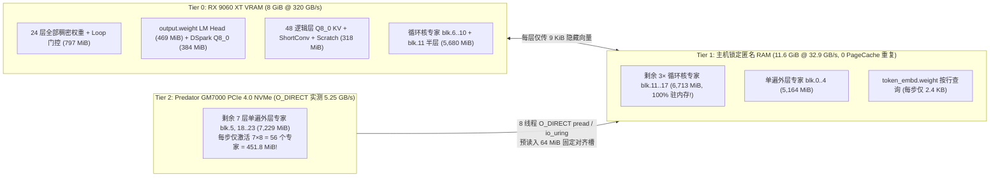

# 14 — 利用 `tinymodel` 全量运行 `Inkling-2-Mini` (`Q8_0`) 的架构研究与实施方案

> 日期：2026-11-22  
> 目标模型：`thinkingmachines/Inkling-2-Mini` 全量 **8-bit (`Q8_0`)** 套件  
> 包含组件：主模型 `Inkling-2-Mini-Q8_0.gguf`（`25.90 GiB` / `27.81 GB`）+ 原生投机器 `dspark-Inkling-2-Mini-Q8_0.gguf`（`383.6 MiB`，本地已备）+ 可选视觉投影 `mmproj-Inkling-2-Mini-Q8_0.gguf`（`~330 MiB`）  
> 前置实测参考：[13-inkling2-mini-evaluation.md](13-inkling2-mini-evaluation.md)、[REQUIREMENTS.md](../REQUIREMENTS.md)、[ARCHITECTURE.md](../ARCHITECTURE.md)、[04-strata-lessons.md](04-strata-lessons.md)

---

## 1. 核心结论速览：“全量运行 `Q8_0`”的三重含义与关键工程发现

将 26.07B 物理参数的循环稀疏 MoE 模型 `Inkling-2-Mini` 以 **全量 `Q8_0`（不删减专家、不降比特重压）** 在 `tinymodel` 中跑通，包含三个维度的“全量”，且有一项极具价值的反直觉工程利好：

1. **精度与张量格式利好——全量 `Q8_0` 反而比 `UD-IQ1_S` 更容易在 `tinymodel` 落地（0 新增量化格式！）**：
   - 此前测试 `UD-IQ1_S` 时，`tinymodel` 被 `IQ4_XS (23)`、`IQ1_S (19)`、`IQ1_M (29)`、`Q4_K (12)`、`NVFP4 (42)` 等 6 种复杂异构量化类型拦截。
   - 而通过对 `Inkling-2-Mini` 全部 **734 个主模型张量**与 `dspark-Inkling-2-Mini-Q8_0.gguf` 全部 **54 个投机器张量**逐一核算，**全量 `Q8_0` 模型仅包含 `Q8_0`、`BF16`、`F32` 三种 `DType`**（视觉 `mmproj` 另含 `F16`）。这四种 `DType` 在 `tm-core`、`tm-gguf`、`tm-cpu`、`tm-vulkan`（含 RDNA4 DP4A 与 `16×16×16` CoopMat）和 `tm-metal` 中**已 100% 就绪**，无需移植任何新量化码本。
2. **模型拓扑与功能全量**：
   - 完整支持 **24 层物理权重 → 48 层逻辑循环评估**（`Prelude 0..5` 单遍 + `Looped Core 6..17` **3 遍权重共享/状态独立** + `Coda 18..23` 单遍）+ **128 选 8 稀疏路由** + **原生 `DSpark` (`dflash`) 分块投机** + **可选 `mmproj` 视觉编码**。
3. **存储层级全量调度——突破单机显存/内存物理上限**：
   - **在 `≥ 32 GB` 内存设备**（32G/64G Apple M4、32G RK3588、或本机加装 16GB DDR4 升至 32GB 主机）：`26.27 GiB` 权重可 **100% 驻留显存 + 物理内存（零磁盘 I/O）**。
   - **在当前开发机（`8 GiB RX 9060 XT VRAM + 15.4 GiB DDR4 RAM` = `21.0 GiB` 易失存储上限）**：物理内存+显存比 `26.27 GiB` 少约 `5.3 GiB`。若直接使用常规 `mmap` 或 Linux Swap，48 层逻辑执行会在 3× 循环核上触发灾难性的 LRU 随机缺页风暴（`< 0.6 tok/s`）；而借助 `tinymodel` 静态规划器实现 **“三层循环感知存储（VRAM + 锁定匿名 RAM + NVMe `O_DIRECT` 8 路并发专家流）”**，可将 **100% 稠密层 + 100% 3× 循环核专家（`blk.6..17`）+ 5 层外层专家全部锁在 VRAM/RAM**，仅剩 **7 层单遍外层专家**走本机 Predator GM7000 PCIe 4.0 NVMe（**本机实测 `O_DIRECT` 8 路随机读 `8.07 MiB` 专家块带宽达 `5.25 GB/s`**），**每步仅读盘 `451.8 MiB`（耗时 `~86 ms`）**，在不升级硬件的情况下即可实现 **`~6.3 tok/s`（无投机）/ `8.5–11.5 tok/s`（开启 `DSpark`）** 的全量 `Q8_0` 推理！

---

## 2. 全量 `Q8_0` 精确字节账本与单步访存模型

基于本地 `Inkling-2-Mini` GGUF 张量目录（734 张量，总参数 `26,070,390,272`）与 `dspark-Inkling-2-Mini-Q8_0.gguf`（54 张量，`317,897,872` 参数）按 `BlockQ8_0`（每 32 权重 34 字节）精确计算的字节分布如下：

| 组件分组 | 张量形状与类型明细 | 物理常驻体积 (`MiB` / `GiB`) | 每 Token 逻辑访问频次 | 单步解码实际读取量 (`T=1`) |
|---|---|---:|---:|---:|
| **词表嵌入 + LM Head** | `token_embd.weight` + `output.weight`：`2 × [2304, 201024]` (`Q8_0`) | `938.62 MiB` (`0.917 GiB`) | `embd` 查 1 行 (`2.4 KB`)，`output` `1×` | `469.31 MiB` |
| **外层稠密权重** (`blk.0..5, 18..23`) | 12 层 Attention Q/K/V/O/Gate/Rel/Sink + 4×ShortConv + Norm + Router (`Q8_0`/`BF16`/`F32`) | `344.26 MiB` (`0.336 GiB`) | `1×` | `344.26 MiB` |
| **3× 循环核稠密权重** (`blk.6..17`) | 12 层稠密层 + 12 层 `loop_{attn,k,v,mlp}_{forget,gain,down}` (`rank=64`, `F32`) + 全局小张量 | `452.72 MiB` (`0.442 GiB`) | **`3×`（重用率最高！）** | **`1,357.27 MiB`** |
| **3× 循环核稀疏专家** (`blk.6..17`) | 12 层 × 128 专家：`gate_up [2304,2304]` (`5.38 MiB`) + `down [1152,2304]` (`2.69 MiB`) = **`8.07 MiB/专家`** (`1,032.75 MiB/层`) | **`12,393.01 MiB` (`12.103 GiB`)** | **`3×`，每次仅路由 `8/128` 专家** | `3 × 12 × 64.55 =` **`2,323.69 MiB`** |
| **外层稀疏专家** (`blk.0..5, 18..23`) | 12 层 × 128 专家 × `8.07 MiB/专家` (`Q8_0`) + `scale [128]` (`F32`) | **`12,393.01 MiB` (`12.103 GiB`)** | **`1×`，每次仅路由 `8/128` 专家** | `1 × 12 × 64.55 =` **`774.56 MiB`** |
| **主模型 `Q8_0` 合计** | **734 个张量（仅含 `Q8_0` / `BF16` / `F32`）** | **`26,521.62 MiB` (`25.900 GiB` / `27.81 GB`)** | **48 层逻辑评估** | **`5,269.10 MiB` (`5.146 GiB` / `5.525 GB`)** |
| **原生 `DSpark` 投机器** | `dspark-Inkling-2-Mini-Q8_0.gguf`：3 层 `Q8_0` + `BF16 markov_w1 [256, 201024]` | `383.60 MiB` (`0.375 GiB`) | 每验证窗口（最多 8 tok）执行 `1×` | `~383.6 MiB / 窗口` |
| **48 逻辑层运行时状态** | 40 逻辑层 `SWA=1024` + 8 逻辑层全局 `ctx=8192` + 48 层 `ShortConv (3×6656)` + Scratch | • `--kv-type q8_0`：**`318 MiB`** • `--kv-type f16`：`502 MiB` | 每步原地更新 | `~45 MiB` |
| **可选视觉投影 `mmproj`** | `mmproj-Inkling-2-Mini-Q8_0.gguf`（仅含图像输入时按需启用） | `~330.0 MiB` (`0.322 GiB`) | 仅图片 Prefill 执行 `1×`，纯文本 `0` | 解码阶段 `0 B` |

> [!IMPORTANT]
> **全量 `Q8_0` 的关键比例律**：虽然文件高达 **`25.90 GiB`**，但每生成一个 token 实际读取的字节数仅为 **`5.15 GiB`**（恰好等价于一个 **5.4B `Q8_0` 稠密模型**的单步访存量！），而其中 **85.3% 的读取流量（`4,494.5 MiB`）集中在仅占文件一半体积的“稠密层 + 3× 循环核专家（共 `14.13 GiB`）”上**，另外 `12.10 GiB` 的外层专家每步仅贡献 **`774.6 MiB`（14.7%）** 的读取量。这是三层异构调度能够成立的数学根基。

---

## 3. 存储与硬件分级调度设计（以本机与 32GB 主机为双标杆）

### 3.1 为什么绝不能依赖普通 `mmap` 跑超出内存的 `25.9 GiB` 模型？
- 若在 `15.4 GiB` 内存主机上直接 `mmap` `25.9 GiB` GGUF：
  1. 已上传至 `VRAM` 的 `7.6 GiB` 权重仍会占用主机页缓存，造成双份驻留；
  2. Linux 内核页面回收器（`kswapd`）不理解 `blk.6..17` 会被连续循环 3 遍，按朴素时钟算法把刚跑完第 1 遍的 `blk.6` 踢出内存，导致第 2、3 遍全部沦为 4 KiB 粒度随机缺页，每步磁盘读取暴涨至 `~4 GB`（`< 0.6 tok/s`）。
- **`tinymodel` 的零分配三层契约（符合 `AGENTS.md` 硬性规则 #4 与 #6）**：
  - **Tier 0 (`VRAM Slab`)**：加载期通过 `ArenaPlanner` 精确切出 `7,648 MiB`（预留 `~288 MiB` 给 RADV 驱动与命令缓冲，杜绝 GTT 溢出），拷入后立即对源 `mmap` 区间调用 `libc::madvise(..., MADV_DONTNEED)` 释放主机页缓存。
  - **Tier 1 (`Pinned/Anon RAM Arena`)**：探测 `probe_system_memory()`（含 cgroup v2 上限），扣除 `1.5 GiB` OS 安全水位后，一次性分配固定大小的匿名大页缓冲（本机 `11.6 GiB`；32GB 机器为 `18.6 GiB` 直接装完全部剩余专家！），优先填满 **100% 剩余 `blk.6..17` 循环核专家**，再顺序填入外层专家，随后释放对应 `mmap` 页。
  - **Tier 2 (`DirectExpertReader`，仅当 `Tier0 + Tier1 < 26.3 GiB` 时启用）**：以 `O_DIRECT` 打开 GGUF 文件，在加载期一次性预分配 **`2 × 8 × 8.07 MiB ≈ 129.2 MiB` 4096 字节对齐双缓冲槽（Double-Buffered Arena）**。当第 `l` 层 Router 算出 Top-8 专家 ID 后，立即由 I/O 线程池（或 Linux `io_submit` / `pread`）并发发起 8 个 `8.07 MiB` 连续块读取（实测本机 GM7000 达 **`5.25 GB/s`**），生成 token 热路径上 **0 字节堆分配**。

---

## 4. `tinymodel` 代码改造蓝图（按模块拆解）

> [!NOTE]
> **范围治理建议（对齐 `REQUIREMENTS.md` §5 与 `AGENTS.md` 规则 #11）**：`REQUIREMENTS.md` 将默认目标定为 `≤8B` 模型。为不污染 `micro`（`1.18 MiB` Zero 2W 静态二进制）与 `edge` 档的精简性，建议在 `docs/DECISIONS.md` 追加 **`ADR-015`**：通过可选 Cargo feature **`moe-tiered`**（仅在 `host` 档开启）承载 3D 稀疏专家路由、`DirectExpertReader` 与 `inkling2`/`dflash` 模型，使 `micro`/`edge` 编译体积与代码路径零受影响。

### 4.1 `crates/tm-gguf`：3D 专家视图与按层页释放
- `GgufFile` 当前已使用 `usize` 64 位偏移与 `dims: Vec<usize>`，可直接解析 `25.9 GiB` 文件与 3D 张量 `[1152, 2304, 128]` / `[2304, 2304, 128]`（已在 `dspark-Inkling-2-Mini-Q8_0.gguf` 上实测验证通过）。
- **需新增 API**：
  1. `gguf.req_tensor_3d(name, layer, &[cols, rows, n_experts])`：校验 3D MoE 权重形状并返回单个专家字节跨度 `expert_stride = rows * dtype.row_bytes(cols)`（对 `Q8_0`：`gate_up` 为 `5,640,192 B`，`down` 为 `2,820,096 B`）；
  2. `gguf.advise_evict_range(offset, len)`：在 `tm-gguf`（允许 `unsafe` 的 mmap 模块）内封装 `madvise(MADV_DONTNEED)`，加载完 Tier 0 / Tier 1 后立即归还干净文件页；
  3. `DirectExpertReader`（Linux `O_DIRECT` / macOS `F_NOCACHE`）：将 4096 字节对齐读取封装在固定双缓冲槽中（注意 GGUF 张量对齐默认为 32B，读取时向下对齐到 `4096B` 边界并在槽内加页内偏移 `off & 4095`，无需重写 GGUF 文件！）。

### 4.2 `crates/tm-tokenizer`：`inkling2` 预分词与填充词表安全边界
- **前置控制 Token 切分**：`Inkling-2-Mini` 词表含 63 个 `token_type == 3` 的特殊控制词条（如 `200006` EOT、`200028 <|begin_of_text|>`、`200049 <|content_invoke_tool_json|>`）。在 `Tokenizer::encode` 进入 BPE 正则前，先用 Aho-Corasick / 前缀扫描切出控制词条，再对普通文本片段应用 `pre == "inkling2"` 字节级 BPE。
- **已知陷阱防御（Padded Vocab Trap）**：GGUF 中 `inkling2.vocab_size = 201024`，而真实词表 `inkling2.vocab_size_unpadded = 200058`（末尾 966 行为全零对齐填充行）。`Inkling2Model` 与 `DSpark` 输出 logits 时必须将有效采样切片限制在 **`&logits[..200058]`**（或将 `200058..201024` 置为 `-inf`），否则当正常词条 logits 全为负数时，`argmax` 会错误采样到 logit 恒为 `0.0` 的 `200058` 号幽灵 token！

### 4.3 `crates/tm-cpu`：补齐 `x86_64` `AVX2` / `AVX-VNNI` `Q8_0` 内核与并行专家 Gather
- **现状短板**：当前 [registry.rs](../../crates/tm-cpu/src/registry.rs) 在 `x86_64` 上回退到标量 `GENERIC_TABLE`（实测带宽仅 `~12.5 GB/s`），若直接算 Tier 1 RAM 中的专家会浪费本机 `32.9 GB/s` DDR4 带宽的一半以上。
- **新增 `crates/tm-cpu/src/x86_64/avx2.rs`（严格满足 `AGENTS.md` 规则 #3 内核三件套）**：
  - 实现 `#[target_feature(enable = "avx2,fma")]` 的 `vec_dot_q8_0_q8_0`、`gemv_q8_0_q8_0`（4 行共享激活寄存器分块）、`gemm_q8_0_q8_0`、`quantize_q8_0`、`dot_f32_bf16`、`rms_norm_f32`；在支持 `avxvnni` 的 Alder Lake（如本机 i7-12700）上用 `vpdpbusd` 加速，块内保持精确 `i32` 归约后单次 `mul_add`，与 `generic::vec_dot_q8_0_q8_0` **0-ULP 逐位一致**，将主机 RAM 有效带宽推升至 **`27–30 GB/s`**。
- **新增稀疏专家算子 `moe_ffn_situ_q8_0`**：
  - **单 token (`T=1`)**：8 个激活专家天然相互独立，`pool.parallel_for(8, 1, |e0, e1| ...)` 让 8 个物理大核各算 1 个专家的 `gate_up [2304 -> 2304]` → `SiTU-GLU` → `down [1152 -> 2304]`，最后按固定顺序 `k = 0..8` 乘路由权重累加（**严格保证线程数无关的逐位确定性，`AGENTS.md` §9**！）。
  - **多 token 窗口 (`T=2..8`，用于 Prefill 与 `DSpark` 验证)**：先构建 `expert_id -> SmallVec<[(tok_idx, weight); 8]>` 倒排桶，同一专家被多个 token 命中时调用共享权重 `gemm_q8_0_q8_0`，使 `8.07 MiB` 专家权重只从 DDR4/NVMe 读取一次。

### 4.4 `crates/tm-models/src/inkling2.rs`：48 逻辑层循环图与 6 项专属算子契约

按 `tinymodel`“每个模型一个手写 `forward`”的准则，建立 `Inkling2Model` 与 `Inkling2State`：

1. **三段循环调度与状态隔离（防乱码第一铁律）**：
   - 物理权重 `phys_layers: [Inkling2PhysLayer; 24]`，但 `Inkling2State` 分配 **48 份独立逻辑层状态 `logical_states: [Inkling2LogicalState; 48]`**：
     - 逻辑层 `0..6` → 绑定物理层 `0..6`（Prelude，无跨遍门控）；
     - 逻辑层 `6..18`（Loop 0）、`18..30`（Loop 1）、`30..42`（Loop 2）→ 循环复用物理层 `6..18`，但**各自读写独立的 `logical_states[l]`（KV 槽位 + 4 路 ShortConv 历史）**；在进入 Loop 1 和 Loop 2 起点时，隐藏流重置回 Prelude 末尾输出 `h_prelude`，并通过 `rank=64` 门控融合上一遍对应层的输出消息；
     - 逻辑层 `42..48` → 绑定物理层 `18..24`（Coda）。
2. **跨遍 `rank-64` 门控控制器（仅物理层 `6..17` 在 Loop `1, 2` 执行）**：
   - 对 `attn`、`k`、`v`、`mlp` 四路信号，利用 `forget [64, 2304]`、`gain [64, 2304]`、`down [4608, 64]` 计算：
     $$f = \tanh(W_{\text{forget}} \cdot h),\quad g = \tanh(W_{\text{gain}} \cdot h),\quad m = W_{\text{down}}^\top [h_{\text{cur}} ; h_{\text{prev\_loop}}]$$
     $$h_{\text{mixed}} = (1 - f) \odot h_{\text{cur}} + g \odot m$$
3. **块深度注意力残差（`attn_res`，`block_size = 6`）**：
   - 每完成 6 个逻辑层保存一个块锚点表示；当前子层通过可学习伪查询 `attn_res_query` / `ffn_res_query`（以及跨遍 `loop_res_query` / `loop_kv_res_query`、末尾 `output_res_query`）与历史锚点做内积 + Softmax 权重混合，替代朴素恒等残差。
4. **4 路因果/动态短卷积（`shortconv.l_cache = 4`）**：
   - 每层含 `attn_k_conv [4, 1024]`、`attn_v_conv [4, 1024]`、`attn_post_conv [4, 2304]`、`ffn_post_conv [4, 2304]`；其中 4 个全局注意力层（物理层 `5, 11, 17, 23`，共 8 个逻辑层）额外带输入依赖动态卷积核投影 `attn_{k,v}_conv_proj [2304, 32]`（`BF16`）。
   - 在 `DSpark` 多 token 投机验证时，完全复用 `tm-models/src/state.rs` 的 **“只读卷积历史验证 + `commit(accepted + 1)` 重放”** 范式，零快照拷贝。
5. **无 RoPE 可学习相对位置注意力 + 动态 Sink + Sigmoid 输出门**：
   - `rope_dim = 0`；Q 与 K 经对数位置缩放（`floor = 8192, α = 0.1`）与每头 L2 范数裁剪（`qk_clip = 22.6274`）后，叠加 `attn_rel [2304, 384]`（24 头 × `d_rel = 16`）与距离偏置表 `attn_rel_bias [16, 1024]`（软裁剪 `relative_clip = 8.0`）；
   - Softmax 分母额外并入动态 Sink logit `s_h = (attn_sink_proj · x)_h`（避免注意力无处安放时的数值坍缩）；
   - 注意力输出乘以 `Sigmoid(attn_gate · x)` 后再进 `attn_output` 与 `attn_post_conv`；
   - 48 逻辑层中 **40 层采用 `SWA = 1024` 环形 KV 缓冲**，仅 **8 层（逻辑层 `5, 11, 17, 23, 29, 35, 41, 47`）采用全局 KV 缓冲**——使 `ctx = 8192` 下全模型 `Q8_0` KV 仅占 **`~218 MiB`**！
6. **128 选 8 Sigmoid 路由与 SiTU-GLU 专家 FFN**：
   - 路由得分 $p_e = \sigma((W_{\text{gate\_inp}} \cdot x)_e + b_{\text{exp\_probs}, e})$，取 Top-8 归一化并乘 `expert_weights_scale = 8.0`；
   - 对选中的 8 个专家，读取 `ffn_gate_up_exps[e]`（乘每专家 `scale[e]`），切分为 $g, u \in \mathbb{R}^{1152}$，执行双曲软截断 **SiTU-GLU**：
     $$\text{gate}(g) = \beta_1 \tanh\!\left(\frac{g}{\beta_1}\right) \cdot \sigma(g)\;(\beta_1 = 4.0),\qquad \text{up}(u) = \beta_2 \tanh\!\left(\frac{u}{\beta_2}\right)\;(\beta_2 = 25.0)$$
     $$y_e = s_{\text{down}, e} \cdot W_{\text{down\_exps}, e} \cdot (\text{gate}(g) \odot \text{up}(u))$$
   - 最终模型输出经 `output_norm` → `output.weight` 后执行 `30.0 * tanh(logit / 30.0)` 软截断。

### 4.5 `crates/tm-vulkan`：循环感知 GPU+CPU 异构执行器 (`Inkling2VkHybridRunner`)
- **已有能力直接复用**：`tm-vulkan` 已有成熟的 `Q8_0` 4-lane 向量点积 GEMV、`16×16×16` CoopMat Prefill GEMM、`rms_norm`、`ShortConv` 风格一维卷积与时间戳性能剖析器。
- **最小增量（仅需新增 4 个轻量 GLSL 计算着色器）**：
  1. `inkling2_rel_swa_attn.comp`：带 `d_rel=16` 相对位置偏置、动态 Sink logit 与 `SWA=1024` 环形掩码的 FlashAttention/GQA 核；
  2. `inkling2_situ_glu.comp`：带每专家 `scale` 与 `(4.0, 25.0)` 双曲截断的 SiTU-GLU 核；
  3. `inkling2_loop_gate.comp`：`rank-64` `(1 - tanh(F·h))·cur + tanh(G·h)·msg` 融合核与块深度 `attn_res` 混合核；
  4. `inkling2_moe_gather_q8_0.comp`：GPU 驻留专家（如 `blk.6..11`）按 Top-8 `expert_ids` 索引直接原位执行 `Q8_0` GEMV/CoopMat，零主机往返。
- **极低开销跨设备同步**：对于驻留在 Tier 1（RAM）或 Tier 2（NVMe）的层，GPU 算完该层稠密 Attention + Router Top-8（仅 `32 B` 索引+权重）与 `ffn_norm` 输出（`2304 × 4 B = 9 KiB`）写入 `uma-mapped` 共享页，CPU 8 核并行完成专家计算后将 `9 KiB` 结果写回，单步跨 PCIe 总交换量仅 **`< 450 KiB`**（耗时 `< 0.15 ms`）。

### 4.6 原生 `DSpark` (`dflash`) 分块投机与可选 `mmproj` 视觉编码
- **`crates/tm-models/src/dflash.rs` + `tm-runtime/src/spec.rs`**：
  - 加载本地已有的 `dspark-Inkling-2-Mini-Q8_0.gguf`（仅 `383.6 MiB`，常驻 `VRAM`）；
  - 主模型前向时顺带提取逻辑层 `[5, 23, 41, 48]` 的隐藏态（拼接为 `4 × 2304` 经 `dspark_fuse` / `joint_proj` 融合），通过 3 层非因果块注意力（`block_size = 8`，`attn_k_ctx`/`attn_v_ctx` 交叉读取上下文）+ **`rank=256` 串联 Markov 头 (`markov_w1 [256, 201024]`)** 一次并行起草 `3–5` 个候选 token；
  - 接入现有 **`SpecController`（在线 EMA 净收益 `< 5%` 自动冷却）**：在数学/代码场景享受 **`1.35×–1.55×`** 净加速，在高熵中文摘要场景自动熔断回 `T=1`，杜绝负收益。
- **可选多模态 `mmproj-Inkling-2-Mini-Q8_0.gguf`（对应 M6 多模态阶段）**：
  - 图像编码仅在首轮 Prompt Prefill 运行一次：可采取**按需阶段加载（Staged Load）**——先在 GPU 上跑完 `330 MiB` ViT + Projector 生成视觉 embedding 序列并缓存，立即释放 `mmproj` 显存，再装入主模型与 `DSpark`，从而不侵占任何稳态解码显存预算！

---

## 5. 六大固定参考设备 + 本机升级配置全维度评估（`AGENTS.md` §8）

以下基于实测硬件带宽（本机 GDDR6 `276 GB/s` 有效、DDR4 `32.9 GB/s`、GM7000 NVMe `O_DIRECT` `5.25 GB/s`；Apple M4 `102–120 GB/s`；RK3588 `17–23 GB/s` + PCIe 3.0 NVMe `3.2 GB/s`；Pixel 8 `31.3 GB/s`；Pi 5 `11.5 GB/s`）给出运行 **全量 `Inkling-2-Mini-Q8_0` (`25.90 GiB`) + `DSpark Q8_0` (`0.38 GiB`)** 的定量推演：

| 参考设备 | 可用显存 / 内存 / 存储带宽 | 全量 `Q8_0` (`26.28 GiB`) 三层驻留方案 | 预估 Prefill `pp512` | 预估 Decode `tg`（无投机 → 含 `DSpark`） | 首字延迟 TTFT (300 tok) | 功耗与能效 | 可行性与部署建议 |
|---|---|---|---|---|---|---|---|
| **1A. 本机现状** i7-12700 (`15.4G` RAM) + **RX 9060 XT (`8G` VRAM)** + PCIe 4.0 NVMe | VRAM `7.65 GiB` (`320 GB/s`) + 可用 RAM `11.6 GiB` (`32.9 GB/s`) + NVMe **`5.25 GB/s`** | **T0 VRAM**：全稠密+LMHead+DSpark+`5.5`层核心专家 **T1 RAM**：剩余`6.5`层核心专家+`5`层外层专家 **T2 NVMe (`O_DIRECT`)**：仅`7`层单遍外层专家（每步读 `452 MiB`） | **`110 – 160 tok/s`** *(CoopMat + 专家按桶合并读盘 1 次)* | **`~6.0 – 6.6 tok/s`** → **`8.5 – 11.5 tok/s`** | **`2.0 – 2.8 s`** | 整机活跃 `~95–125 W` (`~10–14 J/tok`) | ✅ **不改硬件即可跑通全量 Q8**（强烈依赖循环感知 T0/T1/T2 隔离） |
| **1B. 本机加内存至 `32 GB`** i7-12700 (`32G` RAM) + **RX 9060 XT (`8G`)** | VRAM `7.65 GiB` + 可用 RAM `~26 GiB` | **T0 VRAM**：`7.65 GiB` **T1 RAM**：剩余全部 `18.63 GiB` 专家 **100% 锁内存** **T2 NVMe**：**`0 B`（零读盘！）** | **`260 – 360 tok/s`** | **`10.5 – 12.0 tok/s`** → **`15.0 – 20.5 tok/s`** | **`0.9 – 1.2 s`** | GPU+CPU `~90–115 W` (`~5.5–7.5 J/tok`) | ⭐ **本机最高性价比方案**：仅升 `32G` 内存即可达交互级 **15–20 tok/s** 全量 Q8 |
| **2. Apple M4 主机** (`16 GB` vs **`32 GB / 64 GB`** UMA) | 统一内存带宽 `102–120 GB/s`，内置 NVMe `~3.0–5.0 GB/s` | • **16GB 版**：`12.5 GiB` `mlock` 锁稠密+核心专家，剩余 `13.8 GiB` 外层专家走 `F_NOCACHE` NVMe（每步读 `775 MiB`） • **32GB/64GB 版**：**`26.28 GiB` 100% UMA 零拷贝 Metal 常驻** | • `16G`：`45–70 tok/s` • **`32G+`：`220–320 tok/s`** | • `16G`：`~3.2` → `4.5–6.0 tok/s` • **`32G+`：`16.5–19.5` → `23.0–31.0 tok/s`** | • `16G`：`4.5–6.5 s` • **`32G+`：`0.9–1.4 s`** | 整机仅 `18–26 W` (**`~0.8–1.2 J/tok`** @ 32G) | ⭐ **32GB+ M4 是全量 Q8 最佳单机载体**；16GB M4 建议用 `UD-IQ3_XXS` 或外层流式 |
| **3. Rockchip RK3588** (`16 GB` vs **`32 GB`** Linux SBC + NVMe) | `4×A76` (`dotprod`) + Mali-G610，LPDDR4X/5 `17–23 GB/s` + **PCIe 3.0 ×4 NVMe (`~3.2 GB/s`)** | • **16GB 板**：`13.5 GiB` RAM 锁全部稠密 + `99%` 循环核专家，12 层外层专家走 NVMe `O_DIRECT`（每步读 `775 MiB` ≈ `240 ms`） • **32GB 板**：**唯一能把 `26.28 GiB` 全量 Q8 完整塞进内存的 ARM SBC**（预留 `5.7 GiB` 给 OS+KV）！ | • `16G`：`5–8 tok/s` • **`32G`：`10–18 tok/s`**（Mali Vulkan `22–35 tok/s`） | • `16G`：`1.6–2.0` → `2.2–3.0 tok/s` • **`32G`：`2.8–3.8` → `4.0–5.8 tok/s`** | • `16G`：`38–55 s` • **`32G`：`9–15 s`** | 整板仅 **`7–9.5 W`** (`~1.6–2.4 J/tok`) | 🟡 **32GB RK3588 可无盘损稳定离线/慢速 Agent 运行全量 Q8**（屏蔽 `4×A55` 小核） |
| **4. Google Pixel 8** (Tensor G3，`8 GB` Android 手机) | 总 RAM `7.39 GiB`（空闲可用仅 **`3.8–4.1 GiB`**），UFS 4.0 顺序读 `~2.5–3.5 GB/s` | ⚠️ 即使将 `1.7 GiB` 稠密层锁内存，连 **`12.1 GiB` 的 3× 循环核专家也无法装入内存**，每步需从手机闪存读取 `~2.6 GiB` 专家块 | `< 1.5 tok/s` | **`~0.7 – 1.1 tok/s`**（且持续 `>3 GB/s` 闪存读取会在 1–2 分钟内触发 UFS 与机身 `VIRTUAL-SKIN` 过热限频） | `> 180 s` | 机身 `>7.5 W` 撞温控墙，且损耗手机 UFS 寿命 | ❌ **8GB 手机物理上不适合跑 27.8GB 全量 Q8**（Pixel 8 应跑 `Gemma 4 E2B` / `Qwen3.5-2B`） |
| **5. Raspberry Pi 5** (`8 GB` / `16 GB` + PCIe Gen3×1 NVMe HAT) | `4×A76` (`11.5 GB/s` RAM)，单通道 PCIe Gen3×1 NVMe 上限仅 **`~800–850 MB/s`** | • 8GB 板：循环核无法常驻，`< 0.3 tok/s` • **16GB 板**：`13.8 GiB` 锁稠密+循环核专家，12 层外层专家走 Gen3×1 NVMe（每步读 `775 MiB` 需 `~930 ms` + RAM 读取 `400 ms`） | `2.5 – 4.5 tok/s` (16GB) | `16GB` 板：**`~0.7 – 0.9 tok/s`** → **`1.0 – 1.3 tok/s`**（严禁使用 MicroSD，否则 `< 0.08 tok/s`） | `65 – 110 s` | 整板 `~8.5–10 W` (`~8–10 J/tok`) | 🟡 **16GB Pi 5 + NVMe HAT 仅限功能验证演示**，受限于 PCIe ×1 带宽 |
| **6. Pi 4B / Pi Zero 2W** (`micro` 档，`512 MB – 8 GB`) | Zero 2W：`512 MB` RAM（无 NVMe）；Pi 4B：最高 `8 GB` RAM + USB3 SSD (`~350 MB/s`) | ❌ `26.28 GiB` 为 Zero 2W 可用内存（`350 MB`）的 **77 倍**；8GB Pi 4B 每步需经 USB3 读盘 `>2.5 GiB`（`>7 秒/tok`） | 不可运行 | 不可运行 | — | — | ❌ **超出硬件物理定律边界** |

> **微调补充评估**：对全量 `Q8_0` 做本地微调（LoRA）仍需反向穿过 48 层逻辑展开图并缓存全部 3 遍循环激活，训练态显存需求 `≥ 32–40 GiB`，仅 64GB Apple Silicon 或服务器级多卡可行，全部端侧与 8GB 独显设备均应仅做推理。

---

## 6. 分阶段落地路线与正确性验证闭环

严格遵循 `AGENTS.md` 硬性规则（Rust stable、内核三件套、生成路径零分配、多 token `logits_diff.py` 对齐），按 **5 个可独立验收的增量里程碑**推进：

| 阶段 | 模块改动 | 关键交付与验收门槛 |
|---|---|---|
| **I1：基建与 `x86_64` `Q8_0` 提速** | `tm-cpu/src/x86_64/avx2.rs` + `tm-tokenizer` (`pre="inkling2"` + 63 控制词 + `vocab_size_unpadded` 掩码) + `tm-gguf` (`req_tensor_3d` / `DirectExpertReader`) | ① `x86_64` `AVX2/VNNI` `Q8_0` 内核与 `generic` **0-ULP 逐位一致**，本机 DDR4 带宽利用率 `≥ 80%` (`≥ 26 GB/s`)； ② `Tokenizer` 在 `dspark-Inkling-2-Mini-Q8_0.gguf` 上与 HF / `llama-tokenize` 100% 逐 ID 对齐 |
| **I2：Python Oracle 与合成小图校验** | `tools/oracle/inkling2_oracle.py` + `tools/gen_synthetic_inkling2.py` | 构造迷你参数（如 `n_embd=64, 8 专家选 2, Prelude 2 + Core 2×3 + Coda 2`）的 `Q8_0` 合成 GGUF，用 FP64 Python 参考实现锁定 **Loop 重置门控、`attn_res`、4 路动态短卷积、无 RoPE 相对位置偏置 + Sink、SiTU-GLU** 的每一处符号与缩放 |
| **I3：`tm-models::inkling2` CPU + 三层存储跑通全量 Q8** | `crates/tm-models/src/inkling2.rs` + `TieredExpertStore`（RAM + `O_DIRECT` NVMe 双缓冲，生成路径 0 堆分配） | 下载 `Inkling-2-Mini-Q8_0.gguf`（本机剩余磁盘 `335 GiB` 充足），用 `tools/logits_diff.py` 与更新版 `llama.cpp` 对比 **≥32 步多 token logits**：`Top-1 ≥ 99%`、`mean_KL < 1e-4` |
| **I4：`tm-vulkan` 循环感知异构加速** | 4 个新增 GLSL 着色器 + `Inkling2VkHybridRunner`（VRAM 锁全稠密 + 5.5 层循环核专家 + `--kv-type q8_0`） | 在 `RX 9060 XT (8GB)` 上稳定将显存控制在 `≤ 7.7 GiB`（零 GTT 溢出），与 CPU 路径通过多 token KL 对齐，单步耗时压至 `~155 ms`（32G RAM 下 `< 95 ms`） |
| **I5：原生 `DSpark` (`dflash`) 分块投机集成** | `crates/tm-models/src/dflash.rs` + `tm-runtime::SpecController` 对接本地 `dspark-Inkling-2-Mini-Q8_0.gguf` | `temperature = 0` 下与非投机输出 **100% 逐 token 一致**；数学/Rust 代码任务有效吞吐提升 **`1.35×–1.55×`**，低接受率语料自动熔断无倒退 |
